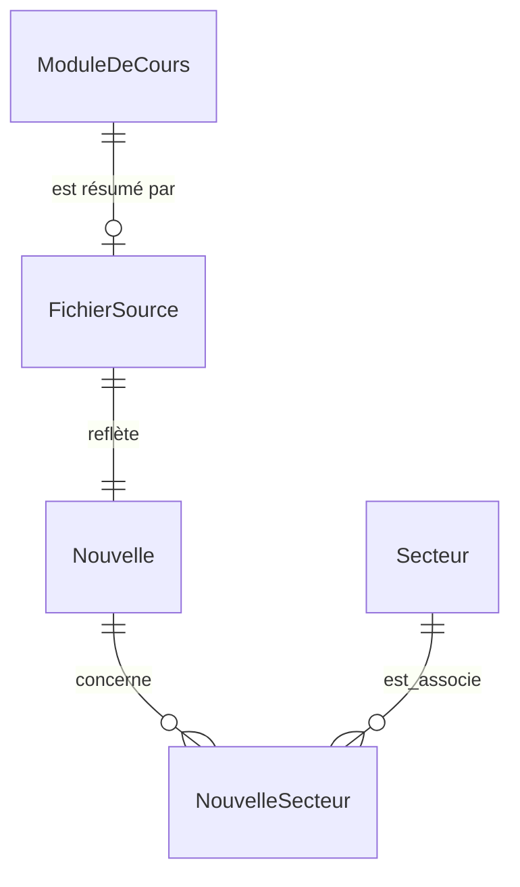
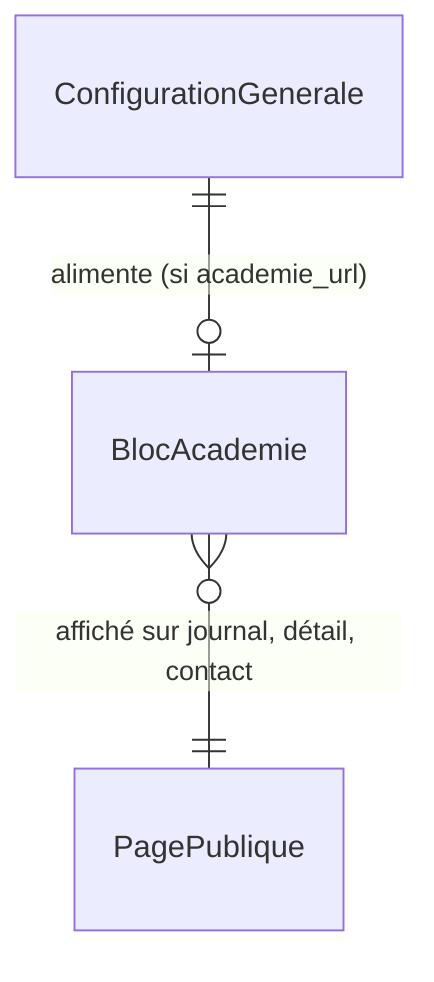
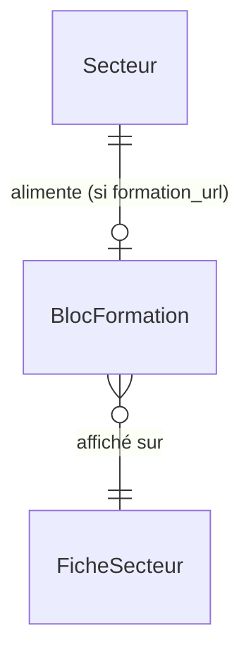
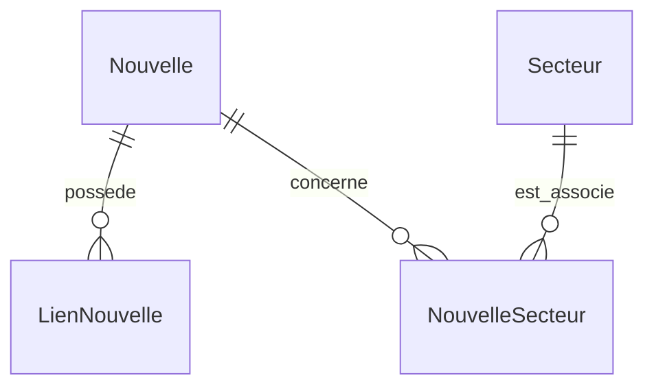

# Ventisax — cadrage validé et entretien de conception

Date du cadrage : 10 octobre 2026. Langue de travail : français.

## Portée et utilisation de ce document

Cette étape consigne le brief, les 34 questions de l'entretien, les options proposées, les réponses reçues et le cahier des charges validé. Elle porte sur la documentation ; le développement de l'application fera l'objet d'une instruction distincte.

Pour les travaux futurs, utiliser les décisions consolidées comme référence et conserver l'historique de l'entretien. Les questions ci-dessous sont des archives : ne pas les reposer ni traiter leurs anciennes formulations comme des tâches à exécuter. Une nouvelle instruction explicite de l'utilisateur peut faire évoluer le cadrage ; documenter alors la décision modifiée.

État constaté avant consignation : dépôt sans application Django, avec un fichier AGENTS.md vide. Aucune application ni aucun déploiement n'a été réalisé pendant cette étape.

## Ajustements visuels autorisés — 10 octobre 2026

La demande explicite « Exécute le projet et ouvre l'application dans le Browser Plugin intégré » autorise l'exécution locale et les corrections de présentation de l'application Django désormais présente. Le brief et l'entretien ci-dessous sont conservés comme historique. Cette vérification locale ne constitue pas un lancement public.

Décisions de style issues de l'inspection dans le navigateur intégré :

- Conserver le bleu profond `#0b2d46`, le fond clair `#f4f7f8`, l'accent turquoise `#68ddce`, les polices système et les assets locaux. Aucune nouvelle direction graphique ni dépendance frontend.
- Séparer visuellement le sélecteur de langue de la navigation principale. Jusqu'à 960 px, placer l'identité et la langue sur la première ligne, puis la navigation en dessous ; jusqu'à 700 px, répartir ses quatre liens sur deux colonnes, avec 8 px entre les cibles. Cela évite les dispositions différentes observées entre français et anglais à 360 px. Les liens conservent au moins 44 px de hauteur et les destinations localisées existantes.
- Sur mobile, porter les titres du fil de nouvelles de 1,05 à 1,125 rem, avec un interligne de 1,4, et les descriptions des cartes secteur à 1 rem. Conserver la hiérarchie des titres et les textes administrables.
- Jusqu'à 380 px, utiliser des marges latérales de 16 px et un remplissage de 20 px dans les cartes secteur et surfaces, afin de préserver la largeur de lecture sur les petits écrans.

Preuves : 48 rendus des six pages publiques dans les deux langues, à 320, 360, 768 et 1 280 px, sans débordement horizontal mesuré ; focus du lien d'évitement transféré au contenu ; changement de langue du détail, filtre, pagination et contact parcourus au clavier. Les 63 tests passent ; `manage.py check` ne signale aucune erreur et `makemigrations --check --dry-run` aucune migration manquante. Les modifications de présentation sont vérifiées par rendu et régressions existantes, conformément à l'exception proportionnée du skill TDD ; aucun nouveau comportement métier n'est ajouté.

L'aperçu utilise `scripts/preview_site.py`, une base et des médias temporaires et un bandeau de démonstration. Les contenus fictifs ne deviennent pas des réalisations publiques. Mesures et captures : `docs/screenshots/refinement-matrix.json`, `refinement-home-360.jpg`, `refinement-contact-320.jpg` et `refinement-home-desktop.jpg`. Les largeurs mobiles sont simulées ; un téléphone physique et un audit exhaustif d'accessibilité ne sont pas couverts par cette passe.

### Retours Browser — menu et contrôles, 10 octobre 2026

Les quatre commentaires explicites de l'utilisateur font évoluer la décision d'en-tête précédente : jusqu'à 960 px, la navigation est désormais repliée par défaut et ouverte par un bouton à trois barres. Elle conserve deux colonnes jusqu'à 700 px lorsqu'elle est ouverte. L'identité, le changement de langue et le bouton de menu restent visibles. Le bouton expose `aria-controls` et `aria-expanded` ; Entrée/Espace l'activent, Échap referme le menu et restitue le focus au bouton. Le passage à l'affichage ordinateur rend la navigation visible.

Le changement de langue est un lien direct vers la traduction courante, présenté sous la forme « Français → English » / « English → Français », abrégée « FR → EN » / « EN → FR » sur mobile, avec un libellé accessible et une infobulle explicites. Il ne nécessite pas de liste déroulante pour les deux langues de la V1.

Le bandeau de démonstration dispose d'une fermeture. Le choix est conservé uniquement dans la session de l'onglet via `sessionStorage` ; si ce stockage est indisponible, la fermeture fonctionne pour la page. Une mention permanente « Démo locale · données fictives » reste dans le pied de page de l'aperçu. Aucun contenu fictif n'est ajouté à la base éditoriale.

Un lien flottant « Retour en haut » apparaît après 500 px de défilement. Son activation ramène en haut et transfère le focus à l'en-tête ; la préférence de réduction des mouvements désactive le défilement animé. Le pied de page réserve de l'espace pour éviter que le contrôle recouvre son lien Contact.

Ces interactions utilisent un seul petit script local différé (`hub/static/hub/site.js`), dans le périmètre JavaScript minimal du PRD. La navigation est rendue visible par Django et repliée par le script : sans JavaScript, elle reste disponible. Aucun framework, traceur ni stockage de données personnelles n'est ajouté.

Validation : test de contrôles accessibles d'abord en échec dans les deux langues (bouton de menu absent), puis suite à 65 tests réussis. Une correction du test traite correctement la présence des attributs HTML booléens, représentés par `None` dans `HTMLParser`. Interactions réelles exercées : ouverture par Entrée, fermeture par Échap et retour du focus, fermeture du bandeau conservée lors du passage au contact, bascule de langue sur le même contact, apparition et activation au clavier du retour en haut. Quatorze combinaisons fr/en à 320, 360, 495, 768, 960, 961 et 1 280 px sans débordement mesuré ; menu replié jusqu'à 960 px et visible au-delà. Preuves dans `docs/validation-interface.md` et `docs/screenshots/controls-matrix.json`. L'absence de JavaScript, le stockage bloqué, les lecteurs d'écran et un téléphone physique n'ont pas été exercés dans cette passe.

### Refonte visuelle inspirée de typinclub.pythonanywhere.com — 14 octobre 2026

La demande explicite de l'utilisateur (« rendre le UI comme https://typinclub.pythonanywhere.com/ ») fait évoluer les décisions de style ci-dessus ; elles restent consignées comme historique. Le design de référence a été relevé avec Playwright (captures et styles calculés), puis transposé avec le skill taste, en préservant structure, URL, contenus administrables, scripts et accessibilité.

- **Police** : Lexend auto-hébergée (`hub/static/hub/fonts/`, woff2 variable 300–800, latin et latin étendu, licence SIL OFL jointe) à la place des polices système. Aucune ressource distante.
- **Palette conservée** : bleu profond `#0b2d46`, fond `#f4f7f8`, turquoise `#68ddce` ; le turquoise sombre `#0d665e` tient le rôle d'accent des liens et étiquettes ; texte `#13212c`.
- **Composants** : en-tête collant translucide, « Contact » en bouton pilule bleu ; boutons, étiquettes, sélecteur de langue et pagination en pilule ; cartes 24 px, surfaces 20 px, champs 12 px. Hero clair, illustration dans un écran sombre arrondi ; secteurs en grille bento teintée ; nouvelles en cartes avec pastille de date ; bandeau d'appel au contact sombre ; pied de page clair ; lecteur vidéo vertical au cadre arrondi.
- **Sobriété** : étiquettes en capitales réduites à deux sur l'accueil ; pas de mode sombre (cadrage en thème clair) ; aucun JavaScript ajouté.

Vérifications : 132 tests réussis ; six pages publiques à 1 280 et 390 px sans débordement ; Lexend chargée ; menu mobile ouvert par Entrée, refermé par Échap avec retour du focus, navigation de nouveau visible au passage en format ordinateur.

**Audit taste, 15 octobre 2026** (demande « vérifie que taste skill est respecté », mode refonte-préservation) : hero limité à quatre éléments (étiquette, titre de deux lignes au plus sur ordinateur, sous-texte de 20 mots au plus, boutons), titre du hero ramené à `clamp(2.25rem, 4.2vw, 3.25rem)` ; ligne d'implantation et point décoratif retirés du hero (l'implantation reste dans le pied de page et sur Contact) ; étiquette « Nos domaines » retirée (une seule étiquette en capitales par page) ; tiret cadratin décoratif de l'état vide retiré ; titre du panneau Contact distinct du libellé de son bouton. Accroche recommandée sans tiret cadratin : « Bientôt votre technicien clim et froid à Yaoundé » / « Soon your cooling technician in Yaoundé ». Passe complète de la check-list ensuite : icônes Tabler Icons (MIT) via `hub/templates/hub/partials/icon.html` à la place des flèches typographiques et des SVG faits main ; numérotation des cartes secteur retirée ; illustration d'accueil réduite au logo (grille décorative retirée) ; en-tête ramené à 72 px ; menu mobile replié en CSS dès le premier rendu (CLS) et rouvert par `<noscript>` sans JavaScript, sans script en ligne. **Mode sombre ajouté sur décision explicite du porteur (16 octobre 2026)**, qui remplace « pas de mode sombre » ci-dessus : il suit le réglage de l'appareil (`prefers-color-scheme`), avec les mêmes bleu et turquoise, des fonds bleu nuit et des jetons sémantiques (`--heading`, `--btn-*`, `--deep`, `--on-deep`). Blanc pur retiré ; bordures de champ portées à 3:1 dans les deux modes. **Choix du thème par le visiteur (22 octobre 2026, demande du porteur)**, qui complète la décision précédente : trois liens « Système », « Clair », « Sombre » (icônes Tabler, libellés accessibles bilingues, `aria-current`) en fin de navigation, donc dans le menu sur mobile. Le choix est un cookie de préférence `theme` (un an, `SameSite=Lax`, `Secure` en HTTPS, sans suivi ni donnée personnelle) lu par Django (`hub/context_processors.py`), qui pose `data-theme` sur `<html>` dès le rendu : aucun flash, aucun script en ligne. Sans JavaScript, chaque lien passe par la vue `theme` (`/theme/<choix>/?next=`, retour limité au site) ; `site.js` applique le choix sans rechargement. « Système » supprime le cookie et suit `prefers-color-scheme`. Entre 961 et 1 260 px, l'en-tête se compacte (langue abrégée, marque sans sous-titre) pour garder la navigation sur une ligne. **Menu mobile (audit taste du 22 octobre 2026)** : jusqu'à 380 px, les quatre liens passent sur une colonne (« Journal de formation » se coupait sur deux lignes en français) ; de 381 à 700 px, deux colonnes comme décidé le 10 octobre. Dans le menu, le sélecteur de thème occupe toute la largeur en trois segments égaux, aligné sur la grille des liens. Sur ordinateur, le sélecteur est allégé (sans cadre ni fond, 44 px comme les liens, seule l'option active teintée) pour que « Contact » reste le seul élément plein de l'en-tête. Le changement de langue reste à côté de l'identité (décision du 10 octobre conservée : ordre de tabulation identique à l'ordre visuel, langue visible sur la première ligne mobile). Écart assumé, imposé par le cadrage : pas de React/Tailwind/Motion. **Image d'accueil administrable (16 octobre 2026, demande du porteur)** : champ `image_accueil` et alternatives `alt_accueil_fr/en` dans `ConfigurationGenerale` (migration `0010`), mêmes règles que l'image d'une nouvelle (2 Mio, 1 600 px, JPEG, alternatives obligatoires avec image), ancienne image supprimée après un remplacement réussi sauf si la base de backup la référence ; sans image, le hero affiche le logo. Une photo n'est chargée que si elle est réelle, si les personnes visibles ont donné leur accord et si ses droits sont acquis ; deux images ont été écartées pour ces raisons. **Reste au porteur** : charger une telle photo dans Unfold.

**Inspection visuelle et ajustements chirurgicaux (22 octobre 2026, demande du porteur)** : application lancée dans l'aperçu (`scripts/preview_site.py`) et inspectée avec Playwright sur neuf pages publiques fr/en, à 320, 360, 390, 768, 960, 961 et 1 280 px, en thèmes clair et sombre (126 combinaisons), au regard des exigences ci-dessus (marges de 16 px et cartes de 20 px jusqu'à 380 px, titres du fil à 1,125 rem et 1,4 sur mobile, en-tête de 72 px, menu replié jusqu'à 960 px, cibles de 44 px, Lexend, une étiquette en capitales par page, aucun débordement). Écarts corrigés dans `hub/static/hub/site.css` : lien de la marque et liens « Pour aller plus loin » portés à 44 px de hauteur (36 à 43 px et 42 px auparavant) ; interligne des titres du fil fixé à 1,3 hors mobile (1,12 rendait serrés les titres sur deux lignes à 768 px), 1,4 conservé sur mobile ; pied de page aligné sur la ligne de base jusqu'à 700 px (le lien « Contact » était décalé) ; bloc Académie : dans une entrée et sur Contact, section ouverte sous un filet plutôt qu'une carte (pas de carte dans la carte, pas de répétition de la carte « Ouverture prochaine »), à la largeur du compte rendu dans une entrée, et boutons pleine largeur à coupure équilibrée jusqu'à 700 px (« e-mail » se coupait en « e- / mail »). Titre du hero sur mobile : minimum relevé de 2,1 à 2,25 rem (`clamp(2.25rem, 9vw, 3rem)` jusqu'à 700 px) pour respecter le plancher de 2,25 rem du 15 octobre à toutes les largeurs ; 36 px de 320 à 390 px, trois lignes en français et deux en anglais comme auparavant, boutons visibles sans défilement, aucun débordement. À la demande du porteur, l'aperçu fictif ne porte plus de vidéo YouTube, de liens Instagram ou Facebook ni d'image de démonstration sur ses nouvelles (`tests/test_preview.py`) ; les champs et leur affichage restent inchangés sur le site. Détail des mesures : `docs/validation-interface.md`.

**Journal de formation, partie 1 (16 octobre 2026, grill avec le porteur)** : une entrée courte par module (modules 1 à 6 de « Habilitation et sécurité professionnelle », 12 au 16 octobre), résumé de trois paragraphes au plus rédigé avec nos mots, ni centre, ni formateur, ni client nommés, aucune photo du manuel publiée. Le compte rendu de manipulation a son propre champ bilingue `compte_rendu_fr/en` (migration `0011`), une ligne « Rubrique : valeur » par rubrique, exigé dans les deux langues dès qu'il est renseigné ; il s'affiche replié en fiche (`
`, liste de définitions). Le journal regroupe les entrées par jour (``, une section par date, date affichée une seule fois) et propose deux affichages (demande du porteur, skill taste) : **liste**, un bloc par jour dont les entrées sont séparées par un filet, et **grille**, des cartes avec un extrait d'une vingtaine de mots, autant de cellules que d'entrées (`auto-fit`). Le choix est porté par l'URL (`?vue=grille`), sans JavaScript, et conservé par le filtre, la pagination et le changement de langue ; une valeur inconnue revient à la liste. Le corps est rendu en vrais paragraphes (`linebreaks`). Textes et images du cours rangés par module dans `programme_shorts_pedago/nouvelles/01_partie1/` (non versionné). Détail dans `docs/validation-interface.md`.

## GOALS

### Évolution autorisée — versions de bases, 10 octobre 2026

La demande explicite de l’utilisateur autorise le développement sur `develop`, puis un commit, de la gestion manuelle des bases dans Unfold : une base courante et un backup persistants, sauvegarde, chargement compatible dans chaque emplacement, permutation et un bouton d’envoi daté de la courante par e-mail à l’administrateur ou à une adresse saisie. Elle autorise aussi les UUID pour les versions et les contenus métier, ainsi que le stockage des instants UTC avec affichage local. Les identifiants internes et les URL existantes sont conservés. Cette décision fait évoluer l’exploitation manuelle initiale ; elle n’ajoute aucune automatisation externe ni autorisation de déploiement. La procédure et les limites sont dans `docs/versions-bd.md`. Conserver l’historique du cadrage ci-dessous.

### Évolution autorisée — nouvelles-leçons et vidéo YouTube, 14 octobre 2026

Un nouvel entretien (skill `grilling`) avec l'utilisateur a fixé ces décisions. Elles font évoluer le cadrage ; le reste de l'historique ci-dessous est conservé.

- **Nouvelles-leçons** : chaque leçon de la formation Froid et Climatisation **réellement suivie** peut devenir une nouvelle : titre = module, `date_jalon` = date du cours, résumé dans le corps fr/en. Rien n'est publié sur les cours à venir ; pas de page Programme. Chaque leçon est rattachée au secteur Climatisation / froid, modules transversaux compris.
- **Droits** : ni nom de formateur, ni extrait ou photo du manuel de cours ; résumé rédigé avec nos mots. Claude propose le texte fr/en, le porteur relit, saisit dans Unfold et publie.
- **Vidéo** : champ facultatif `video_youtube`, limité à une vidéo YouTube unique (watch, shorts, embed, youtu.be ; playlists refusées). La vidéo doit être **non répertoriée** ou publique (une vidéo privée ne se lit pas). Le lecteur est **intégré directement** (iframe `youtube-nocookie.com`, généré à partir de l'identifiant vérifié, jamais d'un code HTML saisi). **Exception assumée à « aucun traceur »**, limitée à ce lecteur : YouTube reçoit une requête à l'affichage d'une nouvelle qui contient une vidéo. Les pages anglaises signalent « Video in French ».
- **Réseaux** : champs facultatifs `instagram_url` et `facebook_url`, domaines vérifiés, affichés en **liens simples** (nouvel onglet, `rel="noopener noreferrer"`) ; aucun lecteur ni SDK Meta.
- **Capsules** : leur appel à l'action ne doit pas promettre de prestation ; la capsule du module 3 est reformulée (« Un projet en clim ou en froid ? Parlons-en »).
- **Livraison** : TDD sur `develop` et commit ; fusion `main` et déploiement seulement après accord explicite.

### Évolution autorisée — acquisition honnête, 15 octobre 2026

L'utilisateur a soumis une stratégie marketing externe : offre d'installation et de dépannage industriels, « devis gratuit », formulaire, rubrique « Les coulisses de notre expertise », vidéos 100 % publiques et démarchage B2B. Un grill (skill `grilling`, Q1–Q16) l'a confrontée à la situation réelle. **Cette stratégie est consignée comme piste future, pas comme tâche à exécuter.** Décisions :

- **Situation (Q1) :** aucune prestation n'est fournie ; le site reste un hub de progression. **Cible (Q2) :** particuliers et petits commerces de Yaoundé ; B2B reporté.
- **Accroche (Q5) :** saisie dans Unfold, par exemple « Ventisax — bientôt votre technicien climatisation et froid à Yaoundé » et « Suivez notre formation, étape par étape », avec leur traduction anglaise. Le statut de projet reste explicite.
- **Appel à l'action (Q6, Q9, Q10) :** bouton « Me prévenir à l'ouverture » / « Notify me at launch » dans le hero, le bandeau d'appel de l'accueil et sur Contact. Il ouvre `wa.me` avec un message fixe et bilingue qui demande le quartier, ou un `mailto:` pré-rempli sans numéro WhatsApp. Rien n'est stocké sur le site ; la pilule « Contact » de l'en-tête reste inchangée. Aucun formulaire ni devis.
- **Rubrique (Q7) :** « Nouvelles » devient « Journal de formation » / « Training log » ; les URL `nouvelles/` ne changent pas. Le mot « expertise » n'est pas revendiqué.
- **Profils (Q8) :** champs facultatifs `youtube_channel_url`, `facebook_url`, `tiktok_url` et `instagram_url` dans `ConfigurationGenerale`, à domaine vérifié, rendus en liens simples dans le pied de page et sur Contact.
- **Vidéos (Q3) :** capsules courtes publiques ; vidéos de leçon non répertoriées ; mêmes interdits (formateur, manuel, apprenants ou locaux sans accord).
- **Réseaux (Q11–Q14) :** Facebook, TikTok et YouTube Shorts (Instagram facultatif) ; WhatsApp Business sans catalogue avec l'étiquette « À prévenir » ; une capsule par leçon réellement suivie ; modèle de description dans `docs/acquisition.md`.
- **Électronique (Q15) :** reste une fiche en préparation, sans mise en avant.
- **Condition de bascule (Q16) :** devis, « Demander une intervention », proposition de valeur affirmative et démarchage B2B ne seront envisagés qu'après une nouvelle décision explicite du porteur, prise quand l'intervention est réellement possible ; le cadrage (hors-scope « formulaire de contact ») sera alors révisé.

Livraison : TDD sur `develop` et commit ; fusion `main` et déploiement de la migration `0009` seulement après accord explicite.

### Évolution autorisée — journal de formation, partie 2 et skill `journal-formation`, 22 octobre 2026

Un grill (skill `grilling`, Q1–Q11) avec l'utilisateur a fixé ces décisions. Elles font évoluer le
cadrage des nouvelles-leçons du 14 octobre ; le reste de l'historique est conservé.

#### 1. Objectifs fonctionnels prioritaires

- **Publier les leçons réellement suivies de la partie 2**, « Les bases de l'électricité domestique »
  / « Domestic electrical basics » : une entrée du Journal de formation par module, datée du cours.
  Module 1 (bases de l'électricité, appareillages et outils) le 19/10/2026 ; module 2 (projet
  d'installation électrique d'une maison neuve) le 20/10 ; modules 3 (simple allumage) et 4 (double
  allumage) le 21/10, deux entrées regroupées sous la même date.
- **Rattachement** : chaque entrée relève du secteur Climatisation / froid, ces modules faisant partie
  de la formation froid et climatisation.
- **Contenu** : titre, slugs fr/en, corps de trois paragraphes au plus et compte rendu de
  manipulation bilingue (`Objet`, `Matériel`, `Déroulement`, `Durée`), selon ce que le porteur a
  confirmé avoir pratiqué : 8 h pour le module 1, 8 h pour le module 2, 4 h + 4 h pour les modules 3
  et 4.
- **Publication directe par Claude** : Claude rédige et publie les entrées sans brouillon soumis
  à relecture préalable ; le porteur relit sur le site après coup et peut dépublier. Cette règle
  remplace, pour le Journal de formation, « Claude propose, le porteur relit, saisit dans Unfold
  et publie » (14 octobre).
- **Skill de projet `journal-formation`** (`.claude/skills/journal-formation/SKILL.md`) pour répéter
  et corriger ces mises à jour : inventaire des modules de `reference/cours/` sans entrée, questions
  au porteur sur les faits (date, pratique, durée), lecture des références, rédaction, publication,
  vérification et sauvegarde. Il sert aussi à corriger une entrée existante.
- **Suite** : les modules 5 à 8 sont traités dans la semaine suivant leur enseignement en présentiel,
  jamais avant.

#### 2. Contraintes techniques

- **Canal** : Unfold de production (`ventisax.pythonanywhere.com/admin/`) piloté par Playwright ;
  le porteur saisit lui-même mot de passe et code e-mail, que Claude ne voit ni ne conserve. La
  validation existante (`full_clean`, `publish()`) s'applique ; aucun code applicatif, script
  d'import, migration ni déploiement.
- **Trace** : un fichier source par module dans `programme_shorts_pedago/nouvelles/02_partie2/`
  (non versionné), au format de la partie 1, avec l'URL publique et la date. Toute correction
  ultérieure y est répercutée ; les slugs publiés ne changent pas.
- **Vérification** : journal et détails en `/fr/` et `/en/` (date, compte rendu replié, changement
  de langue) après publication, puis sauvegarde datée par le bouton « Envoyer la courante par e-mail ».
- **Faits** : dates, pratiques et durées viennent du porteur ; les TAF du manuel ne prouvent pas
  qu'une manipulation a eu lieu.
- **Livraison** : skill et documentation commités sur `develop` ; ni fusion sur `main` ni déploiement,
  le code de l'application ne changeant pas.

#### 3. Périmètre strictement Hors-Scope

- Entrées pour des modules non encore suivis (modules 5 à 8 au 22 octobre) ou pour des cours à venir.
- Nom de formateur, de centre ou de client ; extrait ou photo du manuel ; photo du tableau de la
  classe ; reproduction de la norme NF C 15-100, citée par son nom seulement.
- Image d'illustration sur ces entrées.
- Promesse de prestation ou d'intervention électrique.
- Capsule vidéo, lien YouTube ou réseaux dans le skill (relèvent de `clip-local` et `voix-off-locale`).
- Script d'import, chargement automatique de la base ou accès à la console PythonAnywhere.
- Rattachement au secteur Matériel électronique.

### PRD — Journal de formation, partie 2 et skill `journal-formation` (22 octobre 2026)

**Statut : rédigé à partir des GOALS validés ci-dessus, en attente de validation par l'utilisateur.**
Il précise les comportements attendus. Le PRD V1 ci-dessous reste la référence pour tout ce qu'il ne
modifie pas (publication bilingue, slugs verrouillés, retrait, sécurité).

#### 1. Contexte, problème et résultat attendu

La partie 2 de la formation froid et climatisation, « Les bases de l'électricité domestique », a
commencé le 19 octobre 2026. Ses modules 1 à 4 ont été suivis, mais le Journal de formation ne les
montre pas encore. Les références de cours (pages du manuel, photo du tableau, norme NF C 15-100)
sont privées : elles servent à rédiger, jamais à publier. La partie 1 a été rédigée au cas par cas ;
il faut désormais une procédure répétable, puisque les modules 5 à 8 et les parties suivantes
viendront chaque semaine.

**Résultat attendu :** quatre entrées publiques bilingues, exactes et datées, visibles sur le site
de production, et un skill de projet qui permet de refaire et de corriger ces mises à jour sans
réinventer la procédure ni deviner les faits.

| Rôle | Besoin | Accès |
| --- | --- | --- |
| Visiteur, futur client | Constater la progression réelle de la formation | Pages publiques fr/en |
| Porteur du projet | Fournir les faits (dates, pratique, durées), ouvrir la session d'administration, relire après publication | Unfold, second facteur par e-mail |
| Claude | Rédiger, publier, vérifier, sauvegarder, consigner la source | Navigateur Playwright ouvert sur la session du porteur ; aucun secret conservé |

#### 2. Périmètre

| Élément | Comportement requis |
| --- | --- |
| Entrées de la partie 2 | Module 1 (19/10/2026), module 2 (20/10), modules 3 et 4 (21/10), une entrée chacun, secteur Climatisation / froid, publiées en production |
| Fichiers sources | `programme_shorts_pedago/nouvelles/02_partie2/0N_moduleN/moduleN_<sujet>.md`, un par entrée, au format de la partie 1 |
| Skill | `.claude/skills/journal-formation/SKILL.md`, versionné ; création, correction et inventaire des entrées |
| Documentation | Cette section, `CLAUDE.md` ; commit sur `develop` |

Hors périmètre : voir « Périmètre strictement Hors-Scope » de la sous-section GOALS ci-dessus.

#### 3. User Stories et critères d'acceptation

##### US-16 — Lire les leçons de la partie 2

En tant que futur client, je veux lire ce que Ventisax a appris en électricité domestique afin de
juger une progression réelle.

- Le Journal de formation, en `/fr/nouvelles/` et `/en/nouvelles/`, affiche quatre nouvelles
  entrées sous trois dates : 19, 20 et 21 octobre 2026, avec deux entrées le 21.
- Chaque détail montre le titre, la date du cours, un corps de trois paragraphes au plus, le
  secteur Climatisation / froid et un compte rendu replié dans la langue de la page.
- Le changement de langue mène à la traduction de la même entrée ; aucun texte français n'apparaît
  sur la version anglaise.
- Aucune entrée ne promet une prestation ni une intervention électrique.

##### US-17 — Respecter les faits et les droits

En tant que porteur, je veux que chaque entrée corresponde à ce qui a réellement eu lieu et ne
reproduise aucune source protégée.

- Les dates, les manipulations et les durées sont celles confirmées par le porteur. Un TAF du manuel
  ne suffit pas à affirmer une manipulation.
- Aucun nom de formateur, de centre ni de client. Aucun extrait recopié ni photo du manuel ou du
  tableau. La NF C 15-100 n'est citée que par son nom, sans valeur tirée de ses tableaux.
- Aucune image n'est attachée à ces entrées.

##### US-18 — Publier directement en production

En tant que porteur, je veux que Claude publie les entrées sans que j'aie à les saisir, tout en
gardant la maîtrise de l'accès.

- Le porteur se connecte lui-même (mot de passe et code e-mail) dans le navigateur piloté. Claude ne
  lit, ne note ni ne réutilise aucun secret.
- Chaque entrée est créée dans Unfold avec ses champs bilingues et son secteur, puis publiée par
  l'action « Publier ». Une erreur de validation est corrigée dans le contenu, jamais contournée.
- Une entrée déjà publiée n'est pas dupliquée : avant toute création, Claude cherche un slug
  identique dans Unfold.
- Si la session expire ou si la connexion échoue, Claude s'arrête et signale les entrées publiées et
  restantes.

##### US-19 — Vérifier et sauvegarder après publication

En tant que porteur, je veux une preuve que la publication est visible et une sauvegarde de la base
qui la contient.

- Chaque entrée répond 200 en `/fr/` et en `/en/` sur `ventisax.pythonanywhere.com`, avec son compte
  rendu ; le journal la regroupe sous la bonne date.
- Une sauvegarde datée de la base courante est envoyée par le bouton « Envoyer la courante par
  e-mail » de `/admin/database/`.
- Le compte rendu de session liste les URL publiées, ce qui a été vérifié et ce qui ne l'a pas été.

##### US-20 — Conserver la source de chaque entrée

En tant que porteur, je veux retrouver le texte publié hors de la base afin de le corriger ou de le
réutiliser (capsule, réseaux).

- Chaque entrée a un fichier source qui contient le tableau des champs Unfold, les corps fr/en et
  les comptes rendus fr/en, l'URL publique et la date.
- Le texte du fichier source est identique au texte publié. Toute correction en production y est
  répercutée dans la même session.

##### US-21 — Mettre à jour le journal avec le skill

En tant que porteur, je veux lancer une seule procédure pour publier les modules de la semaine.

- Le skill commence par l'inventaire : il liste les modules de `reference/cours/<partie>/` qui n'ont
  pas de fichier source dans `nouvelles/<partie>/`.
- Avant de rédiger, il demande au porteur la date réelle de chaque module, ce qui a été pratiqué,
  la durée et, pour une nouvelle partie, son intitulé. Il ne rédige rien pour un module dont la date
  n'est pas confirmée.
- Il lit les références (images, pages de PDF), rédige, publie, vérifie, sauvegarde et consigne,
  selon US-16 à US-20.

##### US-22 — Corriger une entrée publiée

En tant que porteur, je veux corriger une entrée publiée sans casser son adresse.

- Le skill modifie l'entrée dans Unfold : titre, corps ou compte rendu, dans les deux langues
  ensemble. Les slugs publiés restent inchangés.
- La correction est vérifiée sur le site, puis reportée dans le fichier source.

#### 4. Règles métier

| ID | Règle |
| --- | --- |
| RJ-01 | Une entrée = un module réellement suivi ; sa date est celle du cours, jamais celle de la rédaction. |
| RJ-02 | Les faits (date, manipulation, durée, intitulé de partie) viennent du porteur ; la référence de cours fournit le vocabulaire, pas la preuve. |
| RJ-03 | Le titre suit le modèle « Formation : … » / « Training: … » ; les slugs suivent `formation-…` / `training-…`, sont uniques et ne changent plus après publication (RM-07). |
| RJ-04 | Le corps compte trois paragraphes au plus par langue, rédigés avec nos mots ; le compte rendu compte une ligne « Rubrique : valeur » par rubrique, dans les deux langues (règle `compte_rendu` existante). |
| RJ-05 | Le secteur des modules de la formation froid et climatisation est Climatisation / froid, modules transversaux compris. |
| RJ-06 | Publication directe par Claude, relecture du porteur après coup ; la dépublication reste son action de retrait (US-11). |
| RJ-07 | Les sources de cours ne sont ni publiées, ni versionnées, ni envoyées à un service externe. |

#### 5. Modélisation logique des données

**Aucune entité persistante, aucun champ et aucune migration ne sont ajoutés.** Les entités du PRD V1 suffisent :

| Entité | Usage dans cette évolution |
| --- | --- |
| Nouvelle | Une instance par module : `titre_fr/en`, `slug_fr/en`, `date_jalon`, `corps_fr/en`, `compte_rendu_fr/en`, `publie`, `premiere_publication` (automatique) ; `image`, `video_youtube`, `instagram_url` et `facebook_url` restent vides |
| NouvelleSecteur | Une association par entrée vers le Secteur « Climatisation / froid » |
| Secteur | Existant, publié ; non modifié |
| LienNouvelle | Non utilisé (aucun lien externe) |
| DatabaseVersion | Inchangé ; l'envoi daté par e-mail de la base courante sert de sauvegarde |

Entités logiques hors base, sur le disque local, non versionnées :

| Entité | Attributs | Contraintes |
| --- | --- | --- |
| ModuleDeCours (référence) | partie, numéro, dossier `reference/cours/<partie>/<module>/`, pages (images, PDF) | Lecture seule ; jamais publiée |
| FichierSource | chemin `nouvelles/<partie>/<NN_moduleN>/moduleN_<sujet>.md`, champs Unfold, corps fr/en, compte rendu fr/en, URL publique, date | Un par Nouvelle ; texte identique au texte publié |

**Décision modifiée (22 octobre 2026, demande explicite d'appliquer le TDD au PRD) :** le skill s'appuie sur
un outillage testé, sans table ni migration : `hub/journal.py` (lecture d'un FichierSource, règles RJ-03/RJ-04,
inventaire, comparaison d'une page publique, `publier` pour l'aperçu et la validation locale) et
`manage.py journal inventaire <partie> | verifier <fichier> [--interdit Nom] | comparer <fichier> [--site URL]`.
La production reste alimentée par Unfold (RJ-06) ; la commande n'écrit jamais dans la base. Ce point remplace,
dans la Definition of Done, « aucun code applicatif n'est modifié ». Journal TDD : `docs/tdd.md`.

#### 6. Definition of Done — critères stricts de validation

Ces cases sont cochées seulement sur preuve observée, pas par la rédaction de ce PRD.

**Outillage testé**

- [x] `tests/test_journal.py` : 14 tests écrits avant le code, échec observé pour la raison attendue, puis verts ;
  suite complète à 159 tests réussis hors les 5 préexistants liés au `.env` ; `check` et
  `makemigrations --check` sans constat.
- [x] Inventaire réel : `02_partie2` signale les modules 1 à 8, `01_partie1` aucun.
- [x] `journal comparer` exercé contre `https://ventisax.pythonanywhere.com` après publication : 8 pages vérifiées, aucun écart.

**Entrées de la partie 2 (US-16 à US-20)**

- [x] Quatre fichiers sources présents dans `nouvelles/02_partie2/`, complets en fr et en en, relus
  contre RJ-01 à RJ-05 et US-17 : aucun nom propre interdit, aucun extrait recopié, trois paragraphes
  au plus.
- [x] Les quatre entrées sont publiées en production (22/10/2026 01:36, créées dans l'ordre module 4, 3, 2, 1 ; secteur réel « Climatisation et froid »), avec les dates 19/10, 20/10, 21/10 et 21/10 et
  le secteur Climatisation / froid, sans doublon ni image.
- [x] Huit détails (quatre entrées × deux langues) répondent 200, avec un compte rendu affiché et un
  changement de langue vers la même entrée ; le journal fr/en regroupe les entrées sous trois dates.
  Une capture Playwright est conservée hors des données privées.
- [x] Le texte publié est identique à celui du fichier source ; l'URL publique y est inscrite.
- [x] La sauvegarde datée par e-mail est envoyée, et son envoi est confirmé par Unfold.
- [x] Aucun secret n'apparaît dans les fichiers, les captures, les commits ou le compte rendu.
  *22/10/2026 : fichiers versionnés sans mot de passe ni secret SMTP ; captures `.playwright-mcp/journal-*.png` relues
  (aperçu local, contenus publics).*

**Skill (US-21, US-22)**

- [x] `.claude/skills/journal-formation/SKILL.md` existe, avec un frontmatter valide (`name`,
  `description` en français et ses déclencheurs). Il décrit l'inventaire, les questions de faits, la
  lecture, la rédaction (modèle de fichier source inclus), la publication, la correction, la
  vérification, la sauvegarde et le compte rendu.
- [x] Le skill renvoie aux règles RJ-01 à RJ-07 et au hors-scope, sans les contredire.
- [x] Inventaire exercé : sur l'état réel, il signale les modules 5 à 8 de la partie 2 comme sans
  entrée, sans rien rédiger avant confirmation de leurs dates.

**Livraison**

- [x] `AGENTS.md`, `CLAUDE.md`, `docs/tdd.md` et le skill sont commités sur `develop` ; `git status` ne montre aucun
  fichier de `programme_shorts_pedago/` ni de donnée locale.
- [x] `hub/journal.py`, la commande `journal` et leurs tests sont commités avec le skill ; la suite
  (`.venv/Scripts/python -m pytest`) et `manage.py check` restent verts hors écarts préexistants signalés.
- [ ] Ni fusion sur `main`, ni déploiement.
  *Écart constaté le 22/10/2026 : le commit `df221b9` (outillage et skill) est contenu dans `main`, emporté par le
  déploiement ultérieur `2dc37a2` ; décision du porteur à consigner.*
- [ ] Le compte rendu final distingue ce qui a été vérifié de ce qui ne l'a pas été (par exemple la
  réception réelle de l'e-mail de sauvegarde).

**Module 5 (22 octobre 2026, décision modifiée à la demande explicite du porteur) :** « Formation : câbler un
va-et-vient » / « Training: wiring two-way switching », cours du 22/10, 8 h, va-et-vient puis double allumage
va-et-vient sur planche, dans une seule entrée (`/fr/nouvelles/formation-va-et-vient/`). Au lieu d'Unfold, le porteur
a demandé la publication directe « avec le skill deploy » : depuis la console PythonAnywhere déjà ouverte, copie
SQLite préalable (`/home/ventisax/backups/avant-module5-20261022.sqlite3`), fichier source transmis en base64
(empreinte SHA-256 identique), `source_errors` sans écart puis `hub.journal.publier` (validation `full_clean` et
`publish()` du modèle), fichier temporaire supprimé. Ce canal déroge, pour cette entrée, au hors-scope « accès à la
console PythonAnywhere » ; `journal comparer` en production : deux pages vérifiées, aucun écart. Sauvegarde par
e-mail non envoyée (session Unfold non ouverte) ; `--interdit` non exercé, relecture manuelle sans nom propre.

**Module 6 (23 octobre 2026, même canal à la demande explicite du porteur, « deploy en utilisant deploy ») :**
« Formation : câbler un télérupteur » / « Training: wiring an impulse relay », cours du 23/10, 8 h, télérupteur
modulaire commandant deux lampes depuis trois boutons-poussoirs, sur planche (`/fr/nouvelles/formation-telerupteur/`,
`/en/nouvelles/training-impulse-relay/`). Aperçu local conforme (journal liste/grille et détails fr/en, 1 280 et
390 px, clair et sombre, sans débordement). Console PythonAnywhere : copie SQLite cohérente par l'API `backup`
(`/home/ventisax/backups/avant-module6-20261023.sqlite3`), fichier source en base64 (SHA-256 identique),
`source_errors` vide, `hub.journal.publier` (id 15, secteur « Climatisation et froid »), fichier temporaire supprimé ;
aucun code ni migration déployés. `journal comparer` en production : deux pages vérifiées, aucun écart ; journal
fr/en regroupé sous le 23 octobre. Sauvegarde par e-mail non envoyée (session Unfold non ouverte) ; `--interdit`
non exercé, relecture manuelle sans nom propre.

### Évolution autorisée — renvoi vers l'Académie Ventisax et demande d'accès, 22 octobre 2026

**Statut : GOALS rédigés à partir du grill (Q1–Q11, toutes les recommandations acceptées), validés par
l'utilisateur, qui a demandé leur transformation en PRD (ci-dessous).** Le reste de l'historique est conservé.

Faits relevés avant le grill : l'e-mail et le numéro WhatsApp sont déjà modifiables à tout moment dans
Unfold (`ConfigurationGenerale`, section « Coordonnées ») ; `acadventisax.pythonanywhere.com` est une
plateforme de cours, quiz et examens, bilingue (bascule FR/EN), accessible par identifiant, qui se
présente aujourd'hui comme celle d'un « centre de formation Ventisax ».

#### 1. Objectifs fonctionnels prioritaires

- **Orienter vers les supports de cours** : un visiteur du Journal de formation qui veut le contenu des
  cours est renvoyé vers l'Académie Ventisax, présentée comme un **espace de révision** (cours et quiz de
  la formation suivie), ouvert sur demande (Q1). Le hub ne la présente jamais comme un centre de formation.
- **Demander un identifiant** par WhatsApp ou par e-mail, avec un message fixe et bilingue pré-rempli qui
  demande le nom et le motif (Q6, Q9) :
  - FR : « Bonjour Ventisax, je souhaite un identifiant pour l'Académie Ventisax. Mon nom : … Pourquoi je
    m'y intéresse : … », objet « Demande d'accès à l'Académie ».
  - EN : « Hello Ventisax, I would like a login for the Ventisax Academy. My name: … Why I'm interested:
    … », objet « Academy access request ».
  Le bouton WhatsApp n'apparaît que si un numéro est renseigné ; le bouton e-mail est toujours présent,
  l'e-mail étant obligatoire.
- **Coordonnées administrables à tout moment** : la demande d'accès réutilise l'e-mail et le WhatsApp
  existants de la configuration générale, source unique déjà partagée par Contact et « Me prévenir » ;
  aucun « contact académie » séparé (Q4).
- **Adresse de l'Académie administrable** : champ facultatif `academie_url` dans la configuration générale,
  saisi dans Unfold ; vide, aucun bloc n'est affiché (Q5).
- **Emplacement** : un bloc « Réviser les cours » / « Review the lessons » sous le titre du Journal de
  formation, en fin de chaque détail d'entrée (après le compte rendu) et sur Contact ; ni dans l'en-tête,
  ni dans le hero de l'accueil, qui restent à « Me prévenir » (Q7).
- **Textes fixes et bilingues** (Q8) : « Les cours et quiz de cette formation sont sur l'Académie Ventisax.
  L'accès se fait avec un identifiant personnel : demandez-le-nous. » / « The lessons and quizzes from this
  training are on the Ventisax Academy. Access requires a personal login: ask us for one. » Boutons
  « Ouvrir l'Académie », « Demander un accès par WhatsApp », « Demander un accès par e-mail » / « Open the
  Academy », « Request access on WhatsApp », « Request access by email ».

#### 2. Contraintes techniques

- **Stack inchangée** : Django, SQLite, Unfold, templates serveur et CSS ; aucun JavaScript ni dépendance
  ajoutés. Un champ `academie_url` (URLField facultatif, validateur http/https existant `HTTP_URL`) et sa
  migration `0012` ; aucune autre entité.
- **Liens** construits par le modèle à partir des coordonnées validées, sur le mécanisme de `notify_url`
  (`wa.me?text=`, `mailto:?subject=&body=`, valeurs encodées) ; libellés et messages dans `LABELS`.
- **Ouverture de l'Académie** : URL saisie telle quelle, nouvel onglet, `rel="noopener noreferrer"`, sans
  mention « in French », l'Académie ayant sa propre bascule de langue (Q10).
- **Confidentialité** : rien n'est stocké sur le hub (ni message, ni demande, ni clic) ; aucun identifiant
  ni mot de passe n'est affiché ou transmis par le hub ; l'attribution se fait hors du site par le porteur.
- **Droits** : le contenu de l'Académie est rédigé par nous ou autorisé, sans reproduction du manuel
  (Q2, RJ-07).
- **Interface** : jetons existants, modes clair et sombre, cibles de 44 px, clavier et focus visibles, sans
  débordement de 320 à 1 280 px.
- **Livraison** (Q11) : TDD sur `develop` (test d'abord en échec, puis vert), `check` et
  `makemigrations --check` propres, consignation dans `AGENTS.md`, `CLAUDE.md` et `docs/tdd.md`, commit.
  Fusion sur `main` et déploiement (migrations `0008` à `0012`) seulement après accord explicite ; le
  porteur saisit ensuite l'URL dans Unfold de production.
- **Reste au porteur, hors dépôt** : corriger sur l'Académie la mention « centre de formation » pour rester
  cohérent avec le statut de projet en formation (Q1).

#### 3. Périmètre strictement Hors-Scope

- Formulaire de demande d'accès, stockage des demandes, notification ou suivi des clics.
- Création de comptes, attribution ou envoi automatique d'identifiants, authentification unique entre le
  hub et l'Académie, reprise ou affichage en iframe du contenu de l'Académie.
- Modification du code ou des textes de l'Académie depuis ce dépôt.
- Prix, mention « gratuit », inscription payante, promesse de formation dispensée ou présentation de
  Ventisax comme centre de formation (Q3).
- Contact WhatsApp ou e-mail distinct pour l'Académie ; messages pré-remplis administrables.
- Bloc Académie dans l'en-tête, le hero ou les pages Présentation et secteurs.
- Publication d'extraits ou de photos du manuel, sur le hub comme via le renvoi.

### PRD — Renvoi vers l'Académie Ventisax et demande d'accès (22 octobre 2026)

**Statut : rédigé à partir des GOALS validés ci-dessus, en attente de validation par l'utilisateur.** Il
précise les comportements attendus et n'autorise pas encore le développement. Le PRD V1 reste la référence
pour tout ce qu'il ne modifie pas (publication bilingue, contact sans stockage, sécurité, accessibilité).

#### 1. Contexte, problème et résultat attendu

Le Journal de formation résume chaque journée de la formation froid et climatisation, mais un visiteur qui
veut aller plus loin (cours, quiz) ne sait pas où les trouver. Ces supports sont sur l'Académie Ventisax
(`acadventisax.pythonanywhere.com`), accessible par identifiant ; le hub ne dit pas qu'elle existe ni
comment obtenir un accès. Les coordonnées de contact sont déjà administrables ; il manque le renvoi, la
demande d'accès pré-remplie et une adresse d'Académie modifiable sans toucher au code.

**Résultat attendu :** sur le journal, chaque entrée et Contact, en français et en anglais, un bloc
discret mène à l'Académie et permet de demander un identifiant par WhatsApp ou e-mail, avec les
coordonnées en vigueur dans Unfold ; le porteur peut changer l'adresse de l'Académie, l'e-mail et le
WhatsApp à tout moment, sans déploiement.

| Rôle | Besoin | Accès |
| --- | --- | --- |
| Visiteur, apprenant ou curieux | Trouver les cours et quiz, demander un identifiant | Pages publiques fr/en |
| Porteur du projet, administrateur | Renseigner ou changer l'adresse de l'Académie et les coordonnées ; attribuer les identifiants hors du site | Unfold, second facteur |

#### 2. Périmètre

| Élément | Comportement requis |
| --- | --- |
| Configuration générale | Champ facultatif « adresse de l'Académie » (http/https), saisi dans Unfold |
| Bloc Académie | Titre, texte, lien « Ouvrir l'Académie », boutons de demande d'accès WhatsApp (si numéro) et e-mail ; affiché seulement si l'adresse est renseignée |
| Pages | Journal de formation (sous le titre), détail d'une entrée (après le compte rendu), Contact ; fr et en |
| Documentation | `AGENTS.md`, `CLAUDE.md`, `docs/tdd.md` ; commit sur `develop` |

Hors périmètre : voir « Périmètre strictement Hors-Scope » des GOALS ci-dessus.

#### 3. User Stories et critères d'acceptation

##### US-23 — Trouver les supports de cours

En tant que visiteur du Journal de formation, je veux savoir où réviser les cours afin d'approfondir une
journée qui m'intéresse.

- Lorsque l'adresse de l'Académie est renseignée, le bloc « Réviser les cours » / « Review the lessons »
  apparaît sous le titre du journal, à la fin de chaque détail d'entrée et sur Contact, dans la langue de
  la page, avec les textes fixés par les GOALS.
- « Ouvrir l'Académie » / « Open the Academy » pointe exactement vers l'adresse saisie, s'ouvre dans un
  nouvel onglet avec `rel="noopener noreferrer"` et un libellé accessible qui annonce l'ouverture externe.
- Le bloc n'apparaît ni sur l'accueil, ni sur Présentation, ni sur les fiches secteur, ni dans l'en-tête.
- Le bloc ne contient ni « centre de formation », ni « gratuit », ni prix, ni promesse de formation.

##### US-24 — Demander un identifiant

En tant que visiteur, je veux demander un accès sans rédiger mon message de zéro.

- « Demander un accès par WhatsApp » ouvre `https://wa.me/<numéro>?text=<message>` avec le message de la
  langue de la page, encodé ; il n'apparaît que si un numéro WhatsApp est renseigné.
- « Demander un accès par e-mail » ouvre `mailto:<e-mail>?subject=<objet>&body=<message>`, encodés,
  dans la langue de la page ; il est toujours présent quand le bloc l'est.
- Le message demande le nom et le motif ; il ne demande ni mot de passe, ni donnée sensible.
- Le hub n'enregistre ni la demande, ni le clic ; aucun identifiant n'est affiché.

##### US-25 — Administrer l'Académie et les coordonnées

En tant qu'administrateur, je veux changer l'adresse de l'Académie, l'e-mail et le WhatsApp à tout moment
dans Unfold.

- Le champ « adresse de l'Académie » figure dans la configuration générale, avec un texte d'aide ; il est
  facultatif.
- Une adresse non http/https (`javascript:`, `data:`, etc.) est refusée sans modifier les valeurs
  enregistrées (RM-10).
- Vider le champ retire le bloc de toutes les pages ; le renseigner l'affiche partout, sans déploiement.
- Modifier l'e-mail ou le WhatsApp met à jour ensemble les liens de Contact, de « Me prévenir » et de la
  demande d'accès.

##### US-26 — Lire le bloc sur mobile, au clavier et dans les deux thèmes

En tant que visiteur sur téléphone ou sans souris, je veux utiliser le bloc comme le reste du site.

- Aucun débordement horizontal de 320 à 1 280 px ; cibles d'au moins 44 px ; ordre de tabulation
  conforme à l'ordre visuel ; focus visible.
- Contraste lisible en thème clair et sombre ; icônes décoratives masquées aux technologies d'assistance.

#### 4. Règles métier

| ID | Règle |
| --- | --- |
| RA-01 | L'Académie est présentée comme un espace de révision ouvert sur demande ; jamais comme un centre de formation ni comme une offre. |
| RA-02 | Une seule source de coordonnées : l'e-mail et le WhatsApp de la configuration générale. |
| RA-03 | Sans adresse d'Académie, aucun bloc ni lien n'est rendu. Sans WhatsApp, seule la demande par e-mail est proposée. |
| RA-04 | Les liens sont construits par le code à partir de valeurs validées et encodées ; aucun HTML ni lien libre saisi. |
| RA-05 | Le hub ne stocke ni ne trace aucune demande ; l'attribution des identifiants se fait hors du site, par le porteur. |
| RA-06 | Les textes et messages du bloc sont fixes et bilingues dans le code ; leur changement passe par une décision et un commit. |
| RA-07 | Le contenu de l'Académie relève de sa propre responsabilité : rédigé par nous ou autorisé, sans reproduction du manuel (RJ-07). |

#### 5. Modélisation logique des données

**Aucune nouvelle entité.** Un attribut est ajouté à une entité existante :

| Entité | Attribut | Type logique | Contraintes |
| --- | --- | --- | --- |
| ConfigurationGenerale | `academie_url` (« adresse de l'Académie ») | URL facultative | Vide par défaut ; http/https seulement (validateur `HTTP_URL`) ; non traduite, l'Académie gérant sa langue |
| ConfigurationGenerale | `email`, `whatsapp` | Existants | Inchangés : e-mail obligatoire, WhatsApp facultatif au format international |

Valeurs dérivées, non stockées : lien d'ouverture de l'Académie, lien WhatsApp pré-rempli, lien e-mail
pré-rempli, calculés à l'affichage selon la langue. Messages et libellés : constantes `LABELS`. Migration
`0012` sur la seule configuration générale ; aucune donnée existante n'est modifiée.

`BlocAcademie` et `PagePublique` sont des notions d'affichage, pas des tables.

#### 6. Definition of Done — critères stricts de validation

Ces cases sont cochées seulement sur preuve observée, pas par la rédaction de ce PRD.

**TDD et contrôles**

- [x] `tests/test_academy.py` écrit avant le code ; échec observé pour la raison attendue (champ ou bloc
  absent), puis vert. Cas couverts : adresse vide (aucun bloc sur les trois pages fr/en) ; adresse
  renseignée (lien exact, nouvel onglet, `rel`, libellés de la langue, présence sur journal, détail,
  Contact, absence sur accueil, présentation, secteur) ; WhatsApp présent ou absent ; encodage des
  messages et objets fr/en ; URL `javascript:`/`data:` refusée ; changement d'e-mail et de numéro reflété ;
  absence de « centre de formation » et de « gratuit ».
- [x] Tests existants de « Me prévenir » et de Contact toujours verts après refactoring de la construction
  des liens.
- [x] Suite complète (`.venv/Scripts/python -m pytest`) verte hors les 5 échecs préexistants liés au `.env` ;
  `manage.py check` et `makemigrations --check --dry-run` sans constat ; migration `0012` appliquée sur une
  base neuve et sur une copie de la base locale sans perte.
  *22/10/2026 : 191 tests, 186 réussis, 5 échecs préexistants liés au `.env` ; `check` et `makemigrations --check`
  sans constat ; migration appliquée sur la base neuve des tests, testée de `0011` à `0012`, et sur une copie de
  `db.sqlite3` (configuration, secteurs, nouvelles et associations identiques). Critères restants (annonce de
  l'ouverture externe, bloc unique, source unique des coordonnées, message sans secret, import `javascript:`
  refusé) testés et mis en échec par mutation (`docs/tdd.md`). Revue des autres stories backend : import refusant
  réseaux hors domaine, playlist et compte rendu unilingue, date de cours absente ou future dans le journal, `.env`
  neutralisé pour la suite ; critères V1 restants (US-01, US-02, US-03, US-08, US-11) testés ; traçabilité de
  chaque story backend dans `docs/tdd.md` ; 202 tests réussis, aucun échec.*

**Parcours réels**

- [ ] Unfold local : saisie, modification, effacement de l'adresse ; adresse `javascript:` refusée avec
  message, valeur précédente conservée.
- [x] Aperçu (`scripts/preview_site.py`) : journal, détail, Contact en fr et en, à 320, 390 et 1 280 px,
  thèmes clair et sombre, sans débordement ; liens `wa.me` et `mailto:` relevés et décodés conformes ;
  parcours clavier avec focus visible. Captures sans donnée privée.
  *22/10/2026, Playwright : 36 combinaisons (6 pages × 320/390/1 280 px × clair/sombre) sans débordement, cibles
  ≥ 44 px, icônes `aria-hidden`, contraste minimal 6,74:1 ; liens décodés conformes fr/en ; à 390 px, ordre de
  tabulation conforme et contour de focus de 3 px. Détail dans `docs/validation-interface.md`.*
- [x] Le bloc reste sobre : un seul élément plein par en-tête conservé, aucune étiquette en capitales
  supplémentaire sur la page (règles taste existantes).

**Livraison**

- [ ] `AGENTS.md`, `CLAUDE.md` et `docs/tdd.md` à jour ; commit sur `develop` ; `git status` sans donnée
  locale ni fichier de `programme_shorts_pedago/`.
- [ ] Ni fusion sur `main`, ni déploiement sans accord explicite. Après accord : migrations `0008` à `0012`
  en production, adresse saisie dans Unfold, bloc vérifié en ligne en fr et en.
- [ ] Le compte rendu distingue le vérifié du non vérifié (ouverture réelle de WhatsApp sur téléphone,
  correction de la mention « centre de formation » sur l'Académie, à la charge du porteur).

### Évolution autorisée — renvoi vers Electro Acad Ventisax depuis le secteur électronique, 23 octobre 2026

**Statut : GOALS rédigés à partir du grill (Q1–Q12, toutes les recommandations acceptées), récapitulatif validé
par l'utilisateur.** Le reste de l'historique est conservé ; les décisions de l'Académie clim (22 octobre) restent
inchangées.

Faits relevés avec Playwright avant et pendant le grill : `electroacadventisax.pythonanywhere.com` est une
plateforme bilingue de cours, quiz et examens d'électronique (une formation, trois parties, 11 modules, 94 h,
certificat par partie). Sans compte, `/` redirige vers la connexion ; le catalogue `/fr/catalogue/` est public ;
l'inscription y est libre, avec confirmation par e-mail, et annoncée « gratuite ». Son pied de page dit
« Ventisax, centre de formation à Yaoundé » et la connexion parle d'« identifiant remis par le centre ». Le porteur
y suit réellement la formation : au 23 octobre, « Révision du courant continu » et « Le courant alternatif » sont
lus (mini-projets exceptés), les autres modules entamés, aucun examen passé. Sur le hub, le secteur publié
« Matériel électronique » / « Electronic equipment » est en préparation, sans nouvelle, avec « Formation en
préparation » comme apprentissages ; son champ `site_url` désigne le futur site sectoriel.

#### 1. Objectifs fonctionnels prioritaires

- **Orienter vers l'électronique en ligne (Q1)** : Electro Acad est présentée comme l'espace où nous apprenons
  l'électronique, ouvert aux curieux ; jamais comme une offre ni comme un centre de formation.
- **Emplacement (Q2)** : un bloc sur la fiche « Matériel électronique » seulement, sous sa description, en `/fr/`
  et `/en/` ; ni en-tête, ni accueil, ni journal, ni Contact.
- **Lien par secteur (Q3, Q8)** : champ facultatif `Secteur.formation_url` (« adresse de la plateforme de cours »),
  saisi dans Unfold ; vide, aucun bloc. Renseigné pour l'électronique seulement ; vide pour « Climatisation et
  froid », déjà renvoyée vers l'Académie par le bloc global. `site_url` conserve son sens de site sectoriel.
- **Appel à l'action (Q4)** : un seul lien, vers l'URL saisie (le catalogue `/fr/`, Q12), sur les deux langues ;
  pas de demande d'accès WhatsApp ou e-mail, l'inscription y étant libre.
- **Textes fixes, bilingues et génériques (Q5, Q7)** : « Approfondir en ligne » / « Go further online » ;
  « Les cours, quiz et examens que nous suivons pour ce secteur sont en ligne, en français et en anglais. » /
  « The lessons, quizzes and exams we follow for this sector are online, in French and in English. » ; lien
  « Voir le programme » / « See the programme ». Ni « centre de formation », ni « gratuit », ni « certificat »,
  ni promesse.
- **Secteur électronique (Q6, Q9, Q10)** : nom et slugs inchangés ; « Apprentissages » et « Prochaine étape »
  mis à jour dans Unfold, sans pourcentage :
  - FR : « Nous suivons en ligne une formation en électronique en trois parties : courant continu et
    semi-conducteurs, courant alternatif et filtres, puis amplification et alimentations. Nous avons commencé par
    la révision du courant continu et le courant alternatif. » ; « Terminer la première partie (diode et
    transistor) et passer son examen. »
  - EN : « We are following an online electronics course in three parts: direct current and semiconductors,
    alternating current and filters, then amplification and power supplies. We started with a review of direct
    current and with alternating current. » ; « Finish the first part (diode and transistor) and take its exam. »
- **Journal (Q11)** : une entrée par partie d'électronique réussie (examen passé), datée de l'examen, rattachée à
  « Matériel électronique », trois paragraphes au plus avec nos mots, compte rendu seulement pour un mini-projet
  réellement monté, ni certificat ni capture de la plateforme. Aucune entrée au 23 octobre. Le skill
  `journal-formation` et la présence du bloc sur le journal seront revus à la première partie réussie.

#### 2. Contraintes techniques

- **Stack inchangée** : Django, SQLite, Unfold, templates serveur et CSS ; aucun JavaScript ni dépendance ajoutés.
  Un champ `URLField` facultatif sur `Secteur` (validateur `HTTP_URL`), migration `0013` ; aucune autre entité.
- **Ouverture** : URL saisie telle quelle, nouvel onglet, `rel="noopener noreferrer"`, mention « (nouvel onglet) »
  / « (new tab) » pour les technologies d'assistance ; pas de mention de langue, la plateforme ayant sa propre bascule.
- **Libellés** dans `LABELS` (RA-06) ; bloc dans un gabarit partiel, rendu par la seule page `sector`.
- **Confidentialité** : rien n'est stocké ni tracé sur le hub ; aucun identifiant affiché.
- **Interface** : jetons existants, clair et sombre, cibles de 44 px, clavier et focus visibles, sans débordement
  de 320 à 1 280 px ; pas de nouvelle étiquette en capitales (règles taste).
- **Livraison (Q12)** : TDD sur `develop` (test d'abord en échec, puis vert), `check` et `makemigrations --check`
  propres, aperçu Playwright, consignation dans `AGENTS.md`, `CLAUDE.md` et `docs/tdd.md`, commit. Déploiement
  (`ventisax-deploy`, migration `0013`) et saisie de l'URL et des textes en production seulement après accord
  explicite du porteur.
- **Reste au porteur, hors dépôt** : corriger sur Electro Acad « centre de formation » et « identifiant remis par
  le centre ».

#### 3. Périmètre strictement Hors-Scope

- Bloc Electro Acad dans l'en-tête, le hero, l'accueil, le journal, les entrées, Contact ou la fiche clim.
- Demande d'accès par WhatsApp ou e-mail, formulaire, création de comptes, authentification partagée, iframe ou
  reprise du contenu de la plateforme.
- Lien distinct par langue, texte du bloc administrable, nom de la plateforme dans le texte fixe.
- Prix, « gratuit », certificats, pourcentage de progression, présentation de Ventisax comme centre de formation.
- Renommage du secteur ou changement de ses slugs ; fusion avec le bloc global de l'Académie clim.
- Entrées de journal électroniques avant une partie réussie ; modification de la plateforme depuis ce dépôt.

#### Décisions modifiées — comparaison taste des fiches secteur, 23 octobre 2026

Demande explicite du porteur (« compare et critique… avec taste skill », puis « applique les recommandations » et
« déploie avec skill deploy »). Elles modifient Q2 et Q8 ci-dessus :

- **Ordre (modifie Q2)** : le renvoi d'un secteur se place après « Apprentissages » et « Prochaine étape », en section
  ouverte sous un filet ; l'état du secteur passe avant le renvoi externe.
- **Clim (modifie Q8)** : quand `formation_url` d'un secteur est l'adresse de l'Académie (`academie_url`), sa fiche
  affiche le bloc Académie existant, avec la demande d'identifiant, à la place du renvoi simple. Pas de nouveau champ :
  le secteur « Climatisation et froid » reçoit l'adresse de l'Académie.
- **Pastilles** : sur une fiche secteur, le journal n'affiche plus la pastille du secteur courant ; les autres
  secteurs d'une entrée restent affichés.
- **Contenus (Unfold ou console, sans code)** : la fiche clim disait « Formation en préparation » et « Commencer la
  formation » au-dessus de 12 entrées réelles ; descriptions des deux secteurs trop génériques. Nouveaux textes :
  - Clim, description : « Notre future activité en climatisation et froid à Yaoundé : nous suivons une formation qui
    commence par la sécurité et l'électricité domestique. » / « Our future air conditioning and refrigeration activity
    in Yaoundé: we are following a training course that starts with safety and domestic electricity. »
  - Clim, apprentissages : partie 1 (habilitation et sécurité professionnelle) et partie 2 (bases de l'électricité
    domestique) d'après les titres publiés du journal ; prochaine étape : minuterie et horloge (interrupteur
    horaire), puis l'électricité industrielle.
  - Électronique, description : « Notre future activité autour du matériel électronique : nous apprenons d'abord
    l'électronique, du courant continu jusqu'aux alimentations. » / « Our future activity around electronic
    equipment: we are first learning electronics, from direct current to power supplies. »
- **Numérotation des modules** : la référence est celle du manuel (`reference/cours/`), confirmée par le porteur
  (module 6 = montage du télérupteur). Le planning affiché en salle numérote autrement (télérupteur en 5) ; il n'est
  pas suivi pour les numéros. Les entrées publiées (« Cinquième module » pour le va-et-vient, « Sixième module » pour
  le télérupteur) restent inchangées.
- Point 6 de la critique (texte de l'état vide) non retenu : gain faible.

### PRD — Renvoi vers Electro Acad Ventisax depuis le secteur électronique (23 octobre 2026)

**Statut : validé par l'utilisateur le 23 octobre 2026, qui a demandé l'implémentation en TDD, l'aperçu, le commit,
puis le déploiement et la saisie en production après passe taste.** Le PRD V1 et celui de l'Académie (22 octobre) restent la référence pour
tout ce qu'il ne modifie pas.

#### 1. Contexte, problème et résultat attendu

Le secteur « Matériel électronique » est en préparation et affirme « Formation en préparation », alors que le
porteur suit désormais une formation d'électronique en ligne sur Electro Acad Ventisax. Un visiteur intéressé par
l'électronique ne trouve ni cette progression ni le chemin vers les cours.

**Résultat attendu :** la fiche électronique, en français et en anglais, dit où nous apprenons l'électronique et
mène au programme en ligne ; le porteur change cette adresse dans Unfold sans déploiement ; les textes du secteur
reflètent la progression réelle.

| Rôle | Besoin | Accès |
| --- | --- | --- |
| Visiteur, curieux d'électronique | Voir ce que nous apprenons et accéder au programme | Pages publiques fr/en |
| Porteur, administrateur | Renseigner, changer ou retirer l'adresse par secteur ; tenir à jour apprentissages et prochaine étape | Unfold, second facteur |

#### 2. Périmètre

| Élément | Comportement requis |
| --- | --- |
| Secteur | Champ facultatif « adresse de la plateforme de cours » (http/https), saisi dans Unfold |
| Bloc « Approfondir en ligne » | Titre, texte fixe, lien « Voir le programme » ; affiché sur la fiche du secteur seulement si l'adresse est renseignée et le secteur publié |
| Contenu | Apprentissages et prochaine étape du secteur électronique, fr/en (GOALS §1), saisis dans Unfold après déploiement |
| Documentation | `AGENTS.md`, `CLAUDE.md`, `docs/tdd.md` ; commit sur `develop` |

#### 3. User Stories et critères d'acceptation

##### US-27 — Approfondir l'électronique en ligne

En tant que visiteur de la fiche électronique, je veux savoir où ces cours se suivent afin d'y accéder.

- Lorsque `formation_url` est renseignée, la fiche du secteur affiche, sous la description, le bloc « Approfondir
  en ligne » / « Go further online » avec les textes fixes des GOALS, dans la langue de la page.
- « Voir le programme » / « See the programme » pointe exactement vers l'adresse saisie, sur les deux langues,
  s'ouvre dans un nouvel onglet avec `rel="noopener noreferrer"` et annonce l'ouverture externe aux technologies
  d'assistance.
- Le bloc n'apparaît sur aucune autre page, ni sur la fiche d'un secteur dont le champ est vide.
- Le bloc ne contient ni « centre de formation », ni « gratuit », ni « certificat », ni prix.

##### US-28 — Administrer l'adresse par secteur

En tant qu'administrateur, je veux renseigner, changer ou retirer l'adresse de la plateforme d'un secteur dans
Unfold.

- Le champ figure dans le formulaire Secteur, avec un texte d'aide ; il est facultatif et non traduit.
- Une adresse non http/https (`javascript:`, `data:`…) est refusée sans modifier les valeurs enregistrées (RM-10),
  y compris sur un secteur publié.
- Vider le champ retire le bloc ; le renseigner l'affiche, sans déploiement. `site_url` et son lien restent
  indépendants.

##### US-29 — Refléter la progression réelle du secteur

En tant que futur client, je veux lire où en est réellement le secteur électronique.

- Après saisie, « Apprentissages » et « Prochaine étape » de la fiche fr/en reprennent les textes des GOALS, sans
  pourcentage ni promesse ; le secteur reste « En préparation », nom et URL inchangés.

##### US-30 — Lire le bloc sur mobile, au clavier et dans les deux thèmes

- Aucun débordement de 320 à 1 280 px ; cible d'au moins 44 px ; ordre de tabulation conforme ; focus visible ;
  contraste lisible en clair et en sombre ; icône décorative masquée.

#### 4. Règles métier

| ID | Règle |
| --- | --- |
| RE-01 | La plateforme est présentée comme l'espace où nous apprenons ; jamais comme une offre ni un centre de formation (comme RA-01). |
| RE-02 | Sans `formation_url`, aucun bloc ; l'adresse vaut pour les deux langues. |
| RE-03 | Seules des URL http/https validées sont rendues ; aucun HTML ni texte libre saisi pour le bloc. |
| RE-04 | Textes du bloc fixes, bilingues et génériques dans le code ; leur changement passe par une décision et un commit. |
| RE-05 | Une entrée de journal électronique correspond à une partie réussie, datée de son examen (décision Q11, mise en œuvre ultérieure). |
| RE-06 | Le hub ne stocke ni ne trace aucun clic ni aucune inscription. |

#### 5. Modélisation logique des données

**Aucune nouvelle entité.** Un attribut est ajouté à une entité existante :

| Entité | Attribut | Type logique | Contraintes |
| --- | --- | --- | --- |
| Secteur | `formation_url` (« adresse de la plateforme de cours ») | URL facultative | Vide par défaut ; http/https seulement (`HTTP_URL`) ; non traduite ; indépendante de `site_url` et de la publication bilingue |

Valeur dérivée, non stockée : le bloc d'affichage. Libellés : `LABELS`. Migration `0013` sur `Secteur` seulement ;
aucune donnée existante modifiée.

`BlocFormation` et `FicheSecteur` sont des notions d'affichage, pas des tables.

#### 6. Definition of Done — critères stricts de validation

Ces cases sont cochées seulement sur preuve observée, pas par la rédaction de ce PRD.

**TDD et contrôles**

- [x] Tests écrits avant le code, échec observé pour la raison attendue (champ ou bloc absent), puis verts. Cas :
  champ vide (aucun bloc fr/en) ; champ renseigné (lien exact sur les deux langues, nouvel onglet, `rel`, mention
  « nouvel onglet », libellés de la langue) ; absence sur accueil, présentation, journal, détail, Contact et autre
  secteur ; `javascript:`/`data:` refusées sans écrasement ; secteur dépublié introuvable ; `site_url` inchangé ;
  absence de « centre de formation », « gratuit », « certificat ».
  *23/10/2026 : `tests/test_formation.py` (7 tests), six en échec sur `TypeError … 'formation_url'`, puis verts ;
  aperçu `tests/test_preview.py` en échec sur `data-formation` absent, puis vert.*
- [x] Suite complète verte ; `manage.py check` et `makemigrations --check --dry-run` sans constat ; migration
  `0013` appliquée sur une base neuve et sur une copie de la base locale sans perte.
  *23/10/2026 : 211 tests réussis, aucun échec ; copie de `db.sqlite3` migrée de `0011` à `0013`, secteurs,
  nouvelles et associations identiques (2, 7, 6).*

**Parcours réels**

- [x] Aperçu (`scripts/preview_site.py`) : fiche électronique fr/en à 320, 390 et 1 280 px, clair et sombre, sans
  débordement ; parcours clavier avec focus visible ; captures sans donnée privée.
  *23/10/2026 : 12 combinaisons, lien 44 px sur une ligne, contraste ≥ 6,33:1, focus 3 px ; passe taste : carte et
  bouton remplacés par une section ouverte sous la description (`docs/validation-interface.md`).*
- [ ] Unfold local : saisie, modification, effacement de l'adresse ; `javascript:` refusée avec message.
  *Exercé par le client de test sur le formulaire Unfold (refus sans perte, effacement) ; pas dans un navigateur.*

**Livraison**

- [x] `AGENTS.md`, `CLAUDE.md`, `docs/tdd.md` à jour ; commit sur `develop` ; `git status` sans donnée locale.
  *23/10/2026 : `d6f958e`.*
- [x] Ni fusion sur `main`, ni déploiement sans accord explicite. Après accord : migration `0013` en production,
  adresse et textes du secteur saisis, fiche vérifiée en ligne en fr et en en.
  *23/10/2026, accord explicite (« deploie avec skill ventisax deploy ») : `d6f958e` déployé, migration `0013`
  appliquée ; adresse et textes enregistrés depuis la console (`Secteur.save()`, validation complète) à la demande du
  porteur, au lieu d'Unfold ; fiche vérifiée en ligne en fr et en en (`docs/deploiement-pythonanywhere.md`).*
- [x] Le compte rendu distingue le vérifié du non vérifié (inscription réelle sur la plateforme, correction de
  « centre de formation » sur Electro Acad à la charge du porteur).
  *Non vérifiés : réception de l'e-mail de sauvegarde, saisie dans le formulaire Unfold réel, inscription sur la
  plateforme, téléphone physique ; mention « centre de formation » toujours présente sur Electro Acad.*

Cette section synthétise les réponses stabilisées du grill et intègre l'exigence TDD demandée ensuite par l'utilisateur. **Statut : validée par l'utilisateur**, qui a demandé sa transformation en PRD. Sa rédaction n'autorise pas encore le développement de l'application.

### 1. Objectifs fonctionnels prioritaires

- **Rendre la progression réelle visible aux futurs clients de Yaoundé et ses environs (Cameroun).** Présenter « Ventisax — projet de groupe en développement », son parcours de formation et son ambition de future SARL, sans présenter des prestations ou ventes comme déjà disponibles.
- **Présenter deux secteurs en préparation : climatisation/froid et matériel électronique.** Chaque fiche synthétique expose description, état préparation/actif, apprentissages et prochaine étape. Permettre l'ajout ultérieur de secteurs concrets, leur ordre d'affichage et un lien vers leur site dédié lorsqu'il existe.
- **Publier des nouvelles réelles et datées.** Une nouvelle concerne zéro, un ou plusieurs secteurs ; distinguer date du jalon et date de première publication. Afficher le fil par date du jalon, avec filtre par secteur et pagination de 10 nouvelles. Sans association publique, la nouvelle apparaît comme une nouvelle du groupe.
- **Offrir un parcours français/anglais complet.** Prévoir accueil, présentation du projet et du parcours, fiches secteur, liste et détail des nouvelles, puis contact. Entrer en français ; utiliser /fr/ et /en/, des URL stables après publication et un sélecteur menant à la traduction du même contenu. Bloquer la publication si l'une des deux traductions est incomplète.
- **Permettre une gestion autonome dans Unfold.** Un administrateur modifie présentations, coordonnées, secteurs, nouvelles et traductions ; utilise brouillons et publication explicite. La dépublication conserve les données. Retirer un secteur masque ses associations publiques sans dépublier les nouvelles ; bloquer la suppression d'un secteur référencé.
- **Faciliter le contact par WhatsApp et e-mail.** Afficher des liens directs vers les coordonnées publiques. Évaluer l'utilité du hub par les contacts reçus et la régularité des publications.
- **Conditionner le lancement à du contenu authentique.** Disposer de la présentation bilingue, des coordonnées, des deux fiches bilingues et d'au moins une nouvelle réelle bilingue. Un jalon de formation est admissible ; aucun contenu fictif ne doit être publié comme une réalisation.

### 2. Contraintes techniques

- **Stack : Django, SQLite et Django Unfold.** Rendre les pages publiques avec les templates Django, du CSS et un minimum de JavaScript. Garder une structure de pages fixe et tous les contenus publics administrables. Administration en français.
- **TDD pour les comportements applicatifs**, selon le skill [test-driven-development](C:/Users/cedric/.codex/skills/test-driven-development/SKILL.md) : écrire un test de comportement, observer son échec pour la raison attendue, implémenter le minimum, puis refactoriser avec les vérifications pertinentes au vert. Pour un refactoring, une couverture existante significative peut suffire. Pour la prose et les changements sans effet comportemental, utiliser une vérification proportionnée plutôt que des tests reproduisant le texte source. Ne jamais affaiblir un test pour le faire passer ; signaler toute vérification non exécutée.
- **Contrats à vérifier :** publication bilingue, exclusion des brouillons, dates et tri, stabilité des URL, filtres/pagination, retrait des secteurs, validation des images, authentification à deux facteurs et restauration des sauvegardes. Vérifier aussi les parcours réels sur mobile et au clavier avant lancement.
- **Hébergement : PythonAnywhere gratuit Beginner**, une application avec un worker, dans un budget global de 512 Mio incluant code, dépendances, SQLite, statiques et médias. Utiliser l'adresse gratuite PythonAnywhere et assurer le renouvellement mensuel ; revérifier les limites de l'offre au déploiement.
- **Contenus légers :** texte simple, liens dans des champs dédiés et une image facultative par nouvelle. Limiter l'envoi à 2 Mio, réduire le plus grand côté à 1 600 pixels maximum, compresser et fournir le texte alternatif dans les deux langues. Les vidéos restent des liens externes.
- **Administration protégée :** mot de passe unique, second facteur par application mobile, codes de récupération conservés hors du site et limitation des tentatives. Utiliser HTTPS et conserver les secrets hors de Git.
- **Exploitation manuelle :** le porteur du projet assure renouvellement et sauvegardes cohérentes de SQLite et des médias, téléchargées hors hébergement chaque semaine où il publie et avant chaque mise à jour technique. Tester la restauration avant lancement.
- **Interface sobre et accessible :** bleu profond, fond clair, accent turquoise, adaptation mobile et navigation clavier.

### 3. Périmètre strictement Hors-Scope

Les éléments suivants sont exclus de la première version. Leur ajout nécessite une décision explicite de l'utilisateur et une mise à jour du cadrage.

- Boutique, catalogue commercial détaillé, commandes, paiements, réservation de prestations et toute présentation d'une offre actuellement opérationnelle.
- Comptes visiteurs, espace client, commentaires, formulaire de contact, stockage des messages et notifications de formulaire.
- Recherche interne, outils de suivi d'audience et tableau de statistiques de consultation.
- Développement, déploiement et contenus détaillés des sites sectoriels ; source de contenus partagée entre plusieurs sites ; domaine personnalisé et sous-domaines Ventisax au lancement.
- Secteurs supplémentaires affichés sans activité ou contenu concret ; réalisations fictives ; affichage de Ventisax comme SARL déjà constituée.
- Équipe éditoriale, rôles multiples et circuit d'approbation des publications.
- Constructeur de pages, éditeur riche, HTML libre, Markdown, historique structuré des changements d'état et indicateurs chiffrés de progression.
- Galeries par nouvelle et téléversement de vidéos ou de PDF.
- API publique, frontend séparé ou application React.
- Automatisation externe de sauvegarde ou de surveillance dans cette version ; l'entretien convenu reste manuel.

## PRD — Ventisax, hub de progression — V1

### 1. Contexte, problème et résultat attendu

Ventisax est un projet de futur groupe SARL, actuellement informel et en formation. Ses premières branches prévues sont la climatisation/froid et le matériel électronique. Le porteur du projet ne dispose pas encore de preuves publiables ni d'offres opérationnelles.

Le hub doit permettre à un futur client de **comprendre le projet, situer son implantation à Yaoundé et ses environs et constater une progression réelle**, puis prendre contact par WhatsApp ou e-mail. Il présente des faits et des étapes de formation, sans promettre de vente ni de prestation actuellement disponible.

La présente spécification transforme les GOALS validés en exigences de première version. Elle définit des comportements attendus ; elle ne constitue ni une application implémentée ni une autorisation de déploiement. Les détails de règles et de données ci-dessous explicitent le cadrage pour éviter des choix contradictoires lors du développement.

**Publics et rôles :**

| Rôle | Besoin principal | Accès |
| --- | --- | --- |
| Visiteur francophone ou anglophone, futur client local | Comprendre le projet, ses secteurs et sa progression, puis contacter son porteur | Lecture publique sans compte |
| Porteur du projet, administrateur unique | Préparer, traduire, publier et retirer les contenus ; gérer les coordonnées | Unfold, authentification à deux facteurs |
| Porteur du projet, responsable de l'exploitation | Renouveler l'hébergement, sauvegarder et restaurer les données | Opérations manuelles privées |

**Réussite produit :** les deux secteurs sont compréhensibles, le statut de projet est explicite, les jalons sont authentiques et lisibles dans les deux langues, les coordonnées fonctionnent et l'administrateur peut publier sans modifier le code. L'utilité sera appréciée par les retours reçus et la régularité des publications, sans traceur de visiteurs ni objectif chiffré arbitraire de conversion.

### 2. Périmètre et parcours publics

Toutes les fonctions de cette V1 sont nécessaires au cadrage retenu. Les exclusions de GOALS restent applicables : aucune boutique, compte visiteur, messagerie, API publique, équipe éditoriale ou site sectoriel à construire dans ce projet.

| Page | Contenu et comportement requis |
| --- | --- |
| Accueil | Identité « Ventisax — projet de groupe en développement », résumé du parcours, implantation, deux secteurs au lancement, dernières nouvelles publiées et accès au contact |
| Présentation | Vision du futur groupe, statut actuel et parcours de formation ; textes administrables, sans revendication de société déjà constituée |
| Fiche secteur | Nom, description, état préparation/actif, apprentissages, prochaine étape, nouvelles associées et lien facultatif vers le site dédié |
| Liste des nouvelles | Jalons publiés du plus récent au plus ancien selon leur date réelle, filtre par secteur public et 10 éléments par page |
| Détail d'une nouvelle | Titre, date du jalon, texte, image facultative et alternative traduite, secteurs publics associés et liens externes facultatifs |
| Contact | Implantation et liens WhatsApp/e-mail valides ; aucun formulaire ni stockage d'un message visiteur |

**Navigation :** routes /fr/ et /en/, redirection de l'entrée / vers /fr/, français par défaut. La langue est explicite dans l'URL. Le sélecteur de langue conserve la page ou le contenu courant ; sur la liste filtrée, il conserve le secteur sélectionné. La pagination peut revenir à la première page lors d'un changement de langue ou de filtre.

**États à traiter :** liste sans nouvelle, secteur sans nouvelle, filtre sans résultat, nouvelle sans image, absence de site dédié, contenu introuvable ou retiré. Les états vides expliquent l'absence sans inventer de contenu. Un contenu dépublié répond 404 à son ancienne adresse publique, dans les deux langues ; une image retirée ne doit pas rester affichée sur la page.

Les routes de pages autres que les préfixes de langue restent des détails de réalisation. Aucun endpoint d'API n'est requis.

### 3. User Stories et critères d'acceptation

#### US-01 — Comprendre Ventisax

En tant que futur client, je veux comprendre la situation actuelle de Ventisax afin de juger le projet sur des informations honnêtes.

- L'accueil et la présentation indiquent le statut de projet en développement, la formation et l'implantation à Yaoundé et ses environs.
- Aucun texte de lancement ne présente la SARL ou une offre commerciale comme déjà opérationnelle.
- Les deux secteurs et les accès à la progression et au contact sont visibles et utilisables dans les deux langues.

#### US-02 — Consulter un secteur

En tant que visiteur, je veux connaître l'état et la prochaine étape d'un secteur afin de suivre son évolution.

- Une fiche publique expose description, état, apprentissages et prochaine étape dans la langue courante.
- Les secteurs suivent l'ordre administré ; seuls les secteurs publiés sont proposés dans la navigation et les filtres.
- Le lien vers un site dédié apparaît uniquement lorsqu'une URL est renseignée ; son absence ne produit aucun lien factice.

#### US-03 — Lire un jalon réel

En tant que visiteur, je veux lire une nouvelle datée afin de comprendre une étape concrète du parcours.

- Le détail affiche la date du jalon, distincte de la date de publication, et le texte de la langue courante.
- L'absence d'image ou de lien externe ne bloque pas la lecture.
- Une nouvelle peut concerner plusieurs secteurs ; seuls ses secteurs publics sont affichés. Sans association publique, elle relève du groupe.

#### US-04 — Filtrer et parcourir les nouvelles

En tant que visiteur, je veux retrouver les jalons d'un secteur sans lire tout le fil.

- Le filtre retourne chaque nouvelle publiée associée au secteur choisi une seule fois, y compris les nouvelles multisecteurs.
- La liste contient au plus 10 nouvelles par page, conserve le filtre lors de la pagination et applique un tri déterministe.
- Une liste vide reste une page normale avec un message explicite. Un secteur inconnu/retiré ou une page de pagination invalide/non existante retourne 404 ; sans contenu, la première page reste valide.

#### US-05 — Changer de langue

En tant que visiteur anglophone ou francophone, je veux accéder à la traduction du même contenu afin de poursuivre ma lecture.

- Les pages, intitulés de navigation, états vides et messages publics existent en français et en anglais.
- Le sélecteur mène à la traduction du même secteur ou de la même nouvelle ; le filtre reste cohérent sur la liste.
- Aucun contenu public incomplet ne provoque un mélange silencieux des langues.

#### US-06 — Contacter le porteur du projet

En tant que futur client, je veux ouvrir WhatsApp ou mon logiciel de messagerie avec les bonnes coordonnées.

- Le lien WhatsApp utilise un numéro au format international ; le lien e-mail utilise l'adresse publique renseignée.
- Les liens sont accessibles sur mobile et au clavier ; leurs libellés décrivent leur destination.
- Le hub n'enregistre pas le message ni un événement de suivi du clic. L'envoi et la réception se déroulent dans les services externes.

#### US-07 — Modifier la présentation et les coordonnées

En tant qu'administrateur, je veux actualiser les contenus généraux dans Unfold sans modifier le code.

- Une configuration générale unique gère la présentation bilingue, le parcours, l'implantation et les coordonnées publiques.
- Une modification invalide est refusée sans remplacer les valeurs précédemment enregistrées.
- Les mises à jour valides sont visibles sur les pages concernées ; les contenus déjà en ligne restent complets dans les deux langues.

#### US-08 — Gérer les secteurs

En tant qu'administrateur, je veux préparer et ordonner les secteurs afin de présenter une évolution concrète du groupe.

- Je peux créer un brouillon, compléter les deux langues, ordonner, publier et dépublier une fiche.
- L'état préparation/actif est indépendant de la visibilité ; au lancement les deux secteurs sont en préparation.
- L'ajout ultérieur d'un secteur utilise la même structure, sans changement de code ; il exige du contenu réel avant publication.

#### US-09 — Préparer une nouvelle

En tant qu'administrateur, je veux saisir un jalon, ses traductions et ses associations sans dupliquer son contenu.

- Un brouillon peut être incomplet et n'est jamais visible publiquement.
- Je saisis une date de jalon, les textes français/anglais, zéro à plusieurs secteurs, une image facultative et des liens externes facultatifs.
- Les liens ont des libellés traduits ; les associations ne créent aucun doublon dans les listes.

#### US-10 — Publier des contenus complets

En tant qu'administrateur, je veux publier explicitement afin de maîtriser ce que les visiteurs voient.

- La publication d'un secteur ou d'une nouvelle est refusée si un contenu requis manque dans une langue ; les erreurs identifient les champs à compléter.
- La publication valide rend les deux versions accessibles ensemble ; la première publication d'une nouvelle est horodatée une seule fois.
- Modifier un titre ou republier ne change ni les URL déjà publiques ni l'horodatage de première publication. Un contenu publié ne peut pas être enregistré dans un état incomplet ; il faut le dépublier pour travailler sur un brouillon incomplet.

#### US-11 — Retirer un contenu sans perdre les données

En tant qu'administrateur, je veux dépublier un contenu afin de le retirer du public tout en pouvant le retravailler.

- Le contenu disparaît des pages, listes et accès directs publics dans les deux langues, mais reste dans Unfold.
- Dépublier un secteur ne dépublie pas ses nouvelles ; les associations en base sont conservées et leurs liens publics masqués.
- Supprimer un secteur associé à une nouvelle, même en brouillon, est refusé. Retirer l'association ou dépublier sont des actions distinctes.

#### US-12 — Ajouter une image légère

En tant qu'administrateur, je veux illustrer une nouvelle sans saturer le stockage.

- Une seule image est possible par nouvelle. Un envoi supérieur à 2 Mio ou un fichier non décodable comme image est refusé.
- Une image acceptée est réduite à 1 600 pixels maximum sur son plus grand côté sans agrandir les petites images, puis compressée ; seule la version utile au site est conservée.
- Les alternatives française et anglaise sont obligatoires pour publier une nouvelle illustrée. Remplacer/retirer l'image évite l'accumulation de fichiers devenus inutiles, sans casser les autres contenus.

#### US-13 — Sécuriser l'administration

En tant qu'administrateur, je veux protéger l'accès aux contenus même si mon mot de passe est compromis.

- Une session non authentifiée, sans second facteur ou sans droit administratif ne peut consulter ni modifier les données d'Unfold.
- Le code temporaire par application mobile est requis ; les tentatives abusives sont limitées. Aucun accès alternatif ne contourne le second facteur.
- Des codes de récupération utilisables une seule fois et une procédure privée de récupération sont disponibles et testés ; aucun secret n'apparaît dans Git ou les pages publiques.

#### US-14 — Sauvegarder et maintenir le hub

En tant que responsable de l'exploitation, je veux récupérer les contenus et maintenir l'application en ligne.

- Une procédure manuelle couvre renouvellement mensuel, sauvegarde cohérente de SQLite et des médias hors hébergement chaque semaine de publication et avant une mise à jour technique.
- Une restauration dans un environnement isolé restitue textes, traductions, associations et images ; elle est démontrée avant lancement.
- L'espace total réellement utilisé sur le compte est mesuré sous 512 Mio avant mise en ligne ; le quota n'est pas considéré comme réservé aux médias.

#### US-15 — Lire sur mobile et au clavier

En tant que visiteur, je veux parcourir le hub sur un téléphone ou sans souris.

- Toutes les pages restent lisibles sans débordement horizontal sur petits écrans ; la navigation, les filtres et les liens fonctionnent au clavier.
- Le focus est visible, les champs ont des libellés, les images ont des alternatives et les états ne reposent pas sur la seule couleur.
- L'interface utilise la direction sobre validée : bleu profond, fond clair et accent turquoise.

### 4. Règles métier et invariants

| ID | Règle |
| --- | --- |
| RM-01 | Un visiteur ne lit que des contenus publiés. Aucune authentification publique n'est nécessaire ; les brouillons ne sont pas exposés par une URL devinable. |
| RM-02 | Les deux traductions requises sont présentes et non composées uniquement d'espaces avant publication ; les textes éditoriaux généraux sont également complets avant lancement. |
| RM-03 | Préparation/actif décrit le secteur ; brouillon/publié décrit sa visibilité. Passer un secteur à actif ne crée pas de boutique ou d'offre de prestation sur le hub. |
| RM-04 | Une nouvelle appartient à zéro ou plusieurs secteurs ; une paire nouvelle/secteur est unique. La visibilité d'un secteur ne modifie pas les associations stockées. |
| RM-05 | La date du jalon est une date civile saisie ; la première publication est un horodatage automatique immuable après initialisation. Tri : date du jalon décroissante, puis identifiant décroissant pour départager les égalités. Fuseau d'affichage : Africa/Douala. |
| RM-06 | Pas de programmation automatique de publication : l'action de publication rend le contenu visible immédiatement. Les jalons annoncés comme accomplis correspondent à des faits réels ; leur authenticité relève de la validation éditoriale du porteur. |
| RM-07 | Chaque identifiant d'URL est unique par type de contenu et par langue. Il peut être préparé en brouillon, puis reste verrouillé après la première publication, même après dépublication. Une collision est refusée avant la mise en ligne. |
| RM-08 | La publication est une transition cohérente : aucune version ne devient publique si la validation d'une traduction, d'un lien ou d'une image échoue. La même validation s'applique aux modifications d'un contenu déjà publié. |
| RM-09 | Dépublier conserve les données. Supprimer un secteur référencé est bloqué, indépendamment de l'état de la nouvelle associée. Aucun retrait de secteur ne supprime en cascade une nouvelle. |
| RM-10 | Les textes simples sont échappés à l'affichage. Les liens de contenus et sites dédiés n'acceptent que des URL http/https ; aucun javascript:, data: ni HTML arbitraire. Les liens de contact sont construits à partir d'un e-mail validé et d'un numéro international validé. |
| RM-11 | Les 2 Mio s'appliquent au fichier envoyé : 2 097 152 octets maximum, limite incluse. Vérifier le décodage réel, limiter les images dangereuses pour les ressources et ne pas se fier seulement à l'extension. Aucun SVG actif, vidéo, PDF ou fichier animé n'est accepté comme illustration. |
| RM-12 | Le retrait public concerne les pages et leurs liens ; une URL de média déjà partagée n'est pas une ressource confidentielle. Ne jamais publier une image privée en supposant que dépublier la nouvelle suffit à révoquer toutes ses copies. |

Les précisions de tri, d'erreurs de pagination, d'intégrité des liens et de traitement des médias sont des conventions opérationnelles de ce PRD. Elles n'ajoutent pas de fonctionnalités hors des GOALS.

### 5. Modélisation logique des données

#### 5.1 Principes

Le modèle métier minimal utilise **quatre entités persistantes**, plus une association nouvelle/secteur. L'authentification repose sur les entités du système Django et du composant de second facteur, sans réimplémenter leur cryptographie.

Pour cette V1 limitée à deux langues, les attributs traduits utilisent des **paires de champs suffixés _fr et _en dans la même entité**. L'état de publication est commun aux deux langues. Pas d'entité de traduction générique ni de gestion d'une troisième langue. Les champs éditoriaux peuvent être incomplets en brouillon ; les exigences de complétude s'appliquent lors de la publication.

Les identifiants sont des clés internes ; les visiteurs utilisent les identifiants d'URL localisés. Les dates de création et de dernière modification servent à la gestion interne, sans créer un historique des versions.

#### 5.2 Entités métier

| Entité | Attributs logiques requis | Contraintes |
| --- | --- | --- |
| ConfigurationGenerale | Identifiant fixe ; identité/resumé d'accueil, présentation du projet, parcours et implantation en paires fr/en ; e-mail public ; numéro WhatsApp international ; date de modification | Une seule configuration ; textes et coordonnées valides avant lancement et après toute modification de la configuration publique ; aucune configuration de secrets dans cette entité |
| Secteur | Identifiant ; nom, identifiant d'URL, description, apprentissages et prochaine étape en paires fr/en ; état préparation/actif ; visibilité brouillon/publié ; ordre d'affichage ; URL facultative du site dédié ; date de première publication ; dates de création/modification | Identifiant d'URL unique par langue ; état distinct de la visibilité ; première publication conservée pour verrouiller les URL ; suppression protégée si référencé |
| Nouvelle | Identifiant ; titre, identifiant d'URL et corps en paires fr/en ; date du jalon ; date de première publication facultative avant publication ; visibilité brouillon/publié ; fichier image facultatif et alternatives fr/en ; dates de création/modification | Publication conditionnée aux deux langues ; date de première publication définie automatiquement une seule fois ; une seule image ; alternatives obligatoires si image ; URL immuables après publication |
| LienNouvelle | Identifiant ; référence à Nouvelle ; URL http/https ; libellé fr/en ; ordre d'affichage | Zéro à plusieurs liens par nouvelle ; libellés requis dans les deux langues pour publier la nouvelle ; un lien est détenu par une seule nouvelle |
| NouvelleSecteur (association) | Référence à Nouvelle ; référence à Secteur | Unicité du couple ; zéro à plusieurs associations des deux côtés ; ne contient ni texte dupliqué ni état de publication |

Il n'est pas nécessaire d'ajouter une entité Image : le fichier facultatif et ses alternatives sont rattachés à Nouvelle. Les médias existent sur disque et doivent être sauvegardés avec SQLite.

#### 5.3 Relations et cycle de vie

- ConfigurationGenerale est indépendante des secteurs et des nouvelles. Les contenus généraux sont structurés par les pages fixes, sans entité Page ni blocs arbitraires.
- Une Nouvelle possède zéro à plusieurs LienNouvelle. La suppression explicite d'une nouvelle supprime ses liens et associations propres, sans supprimer aucun secteur ; la dépublication reste l'action normale de retrait.
- Un Secteur référencé par une Nouvelle ne peut pas être supprimé. Un secteur sans association peut être supprimé explicitement ; aucun retrait ne doit détruire une autre entité métier.
- Les fichiers retirés ou remplacés sont nettoyés seulement après la réussite de la modification correspondante, en vérifiant qu'ils ne sont plus utilisés. Un échec de validation ne détruit pas l'image existante.
- Ordre des secteurs et des liens : ordre d'affichage croissant, puis identifiant croissant en cas d'égalité.

#### 5.4 Entités de sécurité et données exclues

- **Utilisateur administratif** : compte Django avec mot de passe haché et droit administratif. Un seul compte est exploité au lancement ; pas de table client ni d'inscription publique.
- **Dispositif de second facteur** et **codes de récupération** : liés au compte administratif et gérés par le composant de sécurité choisi lors de la réalisation. Les secrets restent privés ; un code de récupération consommé ne peut pas être réutilisé.
- La limitation des tentatives utilise le mécanisme de sécurité retenu, sans ajouter d'outil d'analyse des visiteurs.
- Aucune entité Commande, Paiement, Client, MessageContact, Commentaire, StatistiqueVisiteur, PourcentageProgression ou HistoriqueEtat n'est requise.

### 6. Contraintes non fonctionnelles et exploitation

- **Architecture :** Django, SQLite, Unfold, templates serveur, CSS et JavaScript minimal. Pas de service frontend distinct, d'API publique ou de dépendance de publication à une tâche planifiée.
- **Simplicité éditoriale :** paragraphes en texte simple et liens séparés ; traductions manuelles dans Unfold. Aucun service de traduction automatique n'est nécessaire.
- **Sécurité :** HTTPS, paramètres de production adaptés, secrets hors Git, protection des actions de modification, contrôle administratif et second facteur sur tous les chemins d'accès. Le parcours d'enrôlement ou de récupération n'autorise pas à accéder aux contenus avant vérification.
- **Légèreté :** servir des images optimisées, réserver leur place dans la mise en page et charger les illustrations hors écran à la demande. Ne pas ajouter de vidéos hébergées, de galerie ou de scripts de suivi.
- **Accessibilité :** documents dans la bonne langue, structure de titres cohérente, contraste lisible, focus visible, navigation clavier et messages compréhensibles. Une animation éventuelle doit respecter la réduction des mouvements.
- **Hébergement :** une application et un worker sur PythonAnywhere gratuit ; 512 Mio pour l'ensemble du compte. Vérifier les caractéristiques réelles et la capacité restante lors du déploiement. Le domaine personnalisé reste reporté.
- **Exploitation :** documenter installation, migrations, fichiers statiques/médias, redémarrage, renouvellement mensuel et procédure de sauvegarde/restauration. Une base copiée pendant des écritures doit utiliser une méthode de sauvegarde SQLite cohérente ; un simple fichier copié sans contrôle ne prouve pas la restauration.
- **Observabilité minimale :** erreurs techniques consultables pour le diagnostic, sans exposer secrets ou données d'authentification et sans suivi d'audience. La mesure d'utilité produit reste manuelle.

### 7. Definition of Done — critères stricts de validation

Ces cases décrivent des **preuves à produire lors du futur développement**. Elles ne sont pas cochées par la rédaction du PRD. Aucun pourcentage global de couverture ou score synthétique ne remplace les scénarios observés.

#### 7.1 Une fonctionnalité est terminée uniquement si

- [ ] Ses User Stories et critères d'acceptation sont satisfaits par un comportement observable ; aucune maquette, valeur codée en dur ou simulation ne remplace une fonction requise.
- [ ] Le TDD respecte le skill référencé dans GOALS : pour un nouveau comportement ou une correction, le test échoue d'abord pour la bonne raison, puis passe après la modification ; le refactoring conserve les vérifications au vert. Les exceptions proportionnées prévues par le skill sont déclarées.
- [ ] Les tests ciblés et les régressions pertinentes passent ; aucun test requis n'est ignoré ou affaibli pour obtenir un succès. Le compte rendu contient les commandes, résultats observés et limites éventuelles.
- [ ] Le parcours réel est exercé, au-delà des tests : interaction dans Unfold ou consultation des pages selon la fonction. Les branches d'échec et les limites pertinentes sont également vérifiées.
- [ ] Les changements de modèle ont des migrations applicables sur une base SQLite neuve et, si des données existent déjà, sur une copie de celles-ci sans perte inattendue.
- [ ] Les données de test restent séparées des contenus publics. Aucun secret, mot de passe ou code de récupération n'est ajouté au dépôt.

#### 7.2 La V1 développée est terminée uniquement si la matrice suivante passe

| Contrat | Scénarios minimaux à démontrer | Stories |
| --- | --- | --- |
| Identité et pages | Toutes les pages en français/anglais ; statut de projet et implantation cohérents ; pas d'offre fictive | US-01, US-02 |
| Publication bilingue | Brouillon incomplet invisible ; traduction vide ou faite d'espaces refusée ; publication complète accessible dans les deux langues ; modification invalidante d'un contenu public refusée | US-05, US-07, US-08, US-09, US-10 |
| Dates et URL | Deux jalons publiés dans un ordre différent de leur date réelle ; égalités triées de manière stable ; changement de titre puis dépublication/republication sans changement d'URL ni d'horodatage initial ; collision d'URL refusée | US-03, US-10 |
| Filtre et pagination | Zéro, une, dix et onze nouvelles ; nouvelle multisecteurs sans doublon ; pagination avec filtre conservé ; page et secteur invalides traités selon le contrat | US-04 |
| Langues | Entrée / en français ; bascule du même détail ; filtre conservé au changement de langue ; libellés et états vides traduits | US-05 |
| Retrait et intégrité | Nouvelle retirée introuvable ; secteur retiré absent des filtres/liens mais nouvelles conservées ; suppression d'un secteur référencé par un brouillon refusée ; republication rétablit ses associations visibles | US-08, US-11 |
| Textes et liens | Texte ressemblant à du HTML affiché sans exécution ; URL dangereuse refusée ; liens externes optionnels ordonnés avec libellés traduits | US-03, US-09 |
| Médias | Absence d'image ; image décodable à la limite de 2 Mio ; fichier supérieur à la limite refusé ; faux fichier image refusé ; grande image réduite ; petite image non agrandie ; alternatives incomplètes bloquantes ; remplacement sans perte en cas d'échec et nettoyage après succès | US-12 |
| Contact | Liens WhatsApp et e-mail construits avec les valeurs administrées, ouverts sur appareils adaptés, accessibles au clavier ; aucun message ni événement de suivi créé dans le hub | US-06, US-07 |
| Administration | Données modifiables dans Unfold ; tentatives sans compte, avec mot de passe seul ou sans droit refusées ; code temporaire valide accepté ; limitation des tentatives démontrée ; code de récupération utilisable une seule fois ; absence de voie de contournement | US-07, US-08, US-09, US-13 |
| Mobile et clavier | Parcours sur largeurs 360, 768 et 1 280 pixels, sans débordement ; navigation, filtre, pagination, changement de langue et contact au clavier ; focus et alternatives présents | US-15 |
| Restauration | Sauvegarde cohérente puis restauration dans un environnement isolé ; textes, langues, secteurs, associations, dates et fichiers images restitués | US-14 |

Les dimensions d'écran et jeux de données sont des cas de vérification, pas de nouvelles fonctionnalités. Utiliser des valeurs attendues indépendantes de l'implémentation et ne simuler que les frontières externes nécessaires. L'authenticité des contenus et la qualité des traductions exigent une relecture humaine ; un champ non vide ne les prouve pas.

#### 7.3 La mise en ligne est prête uniquement si

- [ ] Le porteur fournit et relit les textes français/anglais, les coordonnées publiques, les deux secteurs en préparation et au moins une nouvelle réelle. Les illustrations éventuelles sont autorisées à la publication.
- [ ] L'application fonctionne effectivement sur le compte PythonAnywhere choisi : pages publiques, ressources statiques, médias, SQLite et administration protégée. Aucun résultat local ne tient lieu de preuve de déploiement.
- [ ] L'espace total utilisé sur le compte est mesuré **strictement inférieur à 512 Mio** ; la mesure et la marge restante sont consignées. Les limites réelles de l'offre ont été revérifiées.
- [ ] Les contrôles Django de production sont exécutés et leurs constats traités ; HTTPS et la confidentialité des secrets sont vérifiés. Une éventuelle particularité de la plateforme est expliquée, sans masquer un défaut non résolu.
- [ ] Le second facteur est enrôlé pour le compte administrateur et les codes de récupération sont conservés hors du site. Le parcours normal et la récupération ont été exercés.
- [ ] Une sauvegarde restaurable est conservée hors hébergement. Le responsable sait exécuter la procédure et renouveler le site avant l'échéance mensuelle.
- [ ] Le compte rendu de livraison identifie les preuves, commandes, environnement, éventuelles limites et opérations de retour à la version précédente. Un blocage critique de sécurité, de traduction, de données ou de restauration empêche de déclarer le lancement prêt.

#### 7.4 Conformité de sécurité locale — audit du 10 octobre 2026

La demande explicite d'audit autorise ces corrections. Le rapport [docs/audit-securite.md](docs/audit-securite.md) consigne reproductions, correctifs, commandes et limites. Ces cases actent uniquement les critères effectivement éprouvés ; les conditions de lancement de 7.3 restent indépendantes.

- [x] Sondes SQL sur connexion, recherche Unfold et filtre secteur : aucun accès indu, élargissement de résultat ou destruction observés.
- [x] Payloads XSS rendus comme texte sur pages bilingues, listes/formulaires et message de succès Unfold ; liens javascript/data refusés, image polyglotte réencodée sans HTML.
- [x] POST admin sans CSRF ou avec origine étrangère refusés sans modification ; POST légitime réussi dans le navigateur intégré.
- [x] Reprise POST de l'enrôlement TOTP reproduite puis corrigée : un appareil confirmé bloque setup/QR, même depuis une session antérieure ou un wizard en cours.
- [x] Cookie de premier enrôlement reproduit comme réutilisable puis corrigé par rotation ; rotation de connexion, expiration, déconnexion, liaison appareil/utilisateur et permissions métier vérifiées.
- [x] Sessions limitées à 30 minutes d'inactivité, cookies non persistants/HttpOnly/SameSite ; debug par défaut désactivé, clé absente bloquante et paramètres HTTPS/Secure/HSTS vérifiés dans un environnement synthétique.
- [x] TDD observé sur les défauts corrigés ; 92 tests réussis, check et check --deploy sans problème dans leurs environnements respectifs, aucune migration manquante, pip check et smoke/restauration réussis.
- [x] Essais Browser et données synthétiques isolés de la base éditoriale ; captures sans secrets conservées dans docs/screenshots/security-*.jpg.
- [ ] Avant lancement : éprouver certificat, proxy, cookies Secure et mappings sur le compte PythonAnywhere réel, recontrôler les dépendances contre les avis de sécurité et satisfaire 7.3. Cette passe locale n'est ni un audit exhaustif ni une certification.

Décisions modifiées : développement local avec DJANGO_DEBUG=1 explicite ; suite utilisant config.test_settings ; limite d'inactivité de 30 minutes ; compte déjà équipé d'un facteur confirmé orienté vers la récupération privée, sans reprise de l'enrôlement initial. Le brief et l'historique de l'entretien sont conservés.

#### 7.5 Préparation du déploiement — 10 octobre 2026

Décision actualisée à la demande « remplir les données initiales en ligne, modifiables plus tard » :
le contact e-mail validé permet l’initialisation sans inventer de numéro WhatsApp. Ce champ est
facultatif ; s’il est absent, aucun lien WhatsApp n’est rendu. Un numéro renseigné conserve
la validation internationale. Le porteur pourra l’ajouter dans Unfold. Le brief historique
reste conservé ; les critères de lancement et de récupération restent soumis à leurs preuves.
L’option explicite `--announce-classes` initialise seulement l’annonce bilingue autorisée
du 12 octobre 2026, au futur, sans écraser les modifications éditoriales ultérieures.

- [x] Initialisation sans WhatsApp et annonce autorisée éprouvées après échec initial ;
  suite complète à 99 tests réussis, contrôles Django sans erreur et aucune migration manquante.
- [x] SMTP Gmail authentifié avec TLS, message de test accepté pour l’adresse du porteur,
  secret enregistré uniquement dans `.env` privé (600), option e-mail activée, six migrations
  `otp_email` et contrôles de production réussis. La réception et l’enrôlement restent à vérifier.
- [x] Contrôle HTTP distant complet réussi : accueils fr/en et CSS 200, fichiers privés 404,
  admin anonyme 302 vers connexion, connexion 200, cookies sécurisés et HTTP → HTTPS vérifiés.
- [x] Mot de passe administrateur défini par saisie privée ; authentification réussie, facteur
  Courriel enrôlé après réception et validation du code par le porteur, accès réel à Unfold confirmé.
- [x] Numéro WhatsApp public fourni ensuite par le porteur, enregistré via Unfold et lien
  `https://wa.me/237652317898` observé sur Contact en français et en anglais.
- [ ] Codes de récupération conservés hors du site et récupération réelle démontrée.

- [x] Chargement privé de `.env`, priorité des variables du processus et refus du debug dans `config.production` éprouvés en processus isolés.
- [x] Initialisation du brief bilingue idempotente, sans remplacement éditorial ni jalon inventé ; coordonnées invalides refusées sans publication partielle.
- [x] Parcours e-mail OTP éprouvé avec transport de test en mémoire : mot de passe seul refusé par Unfold, code accepté une fois, expiration et limitation des renvois vérifiées. Cela ne prouve pas une livraison SMTP réelle.
- [x] Suite complète : 97 tests réussis. La procédure PythonAnywhere figure à la fin de README.md.
- [ ] SMTP réel, réception et récupération de l'administrateur, contacts publics et lancement vérifiés sur le compte distant.

### 8. Dépendances, risques et séquence de réalisation

Décision explicite du 10 octobre 2026 : l'utilisateur autorise le déploiement sur son compte PythonAnywhere `ventisax`, les commits develop/main et demande les codes OTP par e-mail. L'option e-mail s'ajoute à l'application mobile via les composants existants, avec SMTP privé, expiration de cinq minutes, usage unique et renvoi limité. Le SMTP réel et la réception doivent être éprouvés avant de cocher le lancement. Les secrets restent hors Git. L'initialisation bilingue reprend le brief et exige les coordonnées publiques authentiques ; elle ne remplace pas les contenus existants. Le début des cours et la présentation des locaux sont annoncés pour le 12 octobre 2026, d'après la réponse du porteur ; cette date future ne prouve pas un événement accompli. Les critères de 7.3 restent ouverts tant que leurs preuves manquent.

**Dépendances externes :** disponibilité du compte PythonAnywhere et de sa configuration, fourniture des coordonnées et contenus authentiques par le porteur, rédaction/relecture manuelle en anglais et en français. Les identifiants techniques et versions de dépendances compatibles seront fixés lors de la réalisation ; ne pas ajouter une fonction pour compenser des contenus absents.

**Risques à surveiller :** quota disque consommé par l'environnement et les médias ; cadence de traduction du seul administrateur ; oubli du renouvellement mensuel ; sauvegarde partielle ou non restaurable ; mauvaise intégration du second facteur dans Unfold. Chacun correspond à une vérification ou une procédure exigée dans la Definition of Done.

**Ordre recommandé lorsque le développement sera autorisé :**

1. Préparer le socle Django/SQLite, le harnais de tests, les entités et leurs contraintes ; tests comportementaux avant les fonctions.
2. Mettre en place Unfold, la sécurité administrative, la configuration générale et les transitions de publication bilingue.
3. Construire les pages publiques, la navigation bilingue, les URL stables, filtres, pagination et contacts.
4. Ajouter le traitement des images, exercer les échecs et finaliser les parcours mobile/clavier.
5. Vérifier la matrice de la V1, préparer et démontrer sauvegarde/restauration, puis contrôler le déploiement et les conditions de lancement avec les contenus réels.

Les preuves techniques et les confirmations éditoriales doivent être distinguées. Tant qu'un critère strict n'est pas satisfait, rapporter ce qui est réalisé et ce qui reste à vérifier, sans déclarer la V1 ou son lancement terminés.

## Brief initial et analyse

Le porteur du projet souhaite créer une application web Django avec SQLite et une administration Unfold pour son futur groupe Ventisax SARL. Le projet, encore informel et en formation, prévoit plusieurs branches : climatisation/froid, vente de matériel électronique, puis d'autres activités. Le hub général doit présenter le projet et sa progression ; les futurs sites sectoriels porteront les contenus détaillés. Le brief évoquait un hébergement de « 500 Mo ».

L'entretien a séparé trois ambitions initialement mélangées : présenter le groupe, montrer la progression et attirer des clients. L'objectif prioritaire retenu est de montrer la progression aux clients potentiels. Aucune preuve n'est actuellement publiable et aucune prestation ni vente n'est proposée au lancement. La communication doit donc expliciter le stade de formation, sans faire passer des ambitions pour des activités opérationnelles.

Précisions libres reçues :

- Hébergeur : **PythonAnywhere**, compte gratuit **Beginner**. L'offre est déjà choisie ; le dépôt ne contient toutefois aucune application existante.
- Implantation actuelle : **Yaoundé et ses environs (Cameroun)**. Cette implantation ne constitue pas une promesse de prestations disponibles.

## Décisions consolidées

### Choix explicites de l'utilisateur

- Objectif : montrer une progression réelle aux futurs clients locaux, plutôt que proposer une offre commerciale immédiate.
- Identité publique : « Ventisax — projet de groupe en développement ». La SARL est une ambition future, pas le statut actuel affiché.
- Deux secteurs au lancement : climatisation/froid et matériel électronique, tous deux en préparation. Ajouter les autres secteurs lorsqu'ils deviennent concrets.
- Hub synthétique : fiches courtes et nouvelles datées ; liens vers les sites sectoriels uniquement lorsqu'ils sont disponibles. Les détails, réalisations et offres des futurs sites dédiés restent hors de cette version.
- Pages : accueil, présentation du projet et du parcours, fiches secteur, liste et détail des nouvelles, contact.
- Public bilingue français/anglais. Publication bloquée tant que les deux versions ne sont pas renseignées ; pas de repli silencieux vers le français sur les pages anglaises.
- Tous les contenus publics et les coordonnées sont modifiables dans Unfold ; structure des pages fixe, sans constructeur de pages.
- Un seul administrateur ; brouillons et publication explicite, sans circuit de validation éditoriale.
- Contact par liens WhatsApp et e-mail ; aucun message visiteur stocké dans SQLite.
- Aucun compte visiteur, formulaire, commentaire, boutique, recherche interne ou outil de suivi d'audience en première version.
- Mesure d'utilité : retours reçus par WhatsApp/e-mail et régularité des publications.
- Textes simples avec paragraphes ; liens saisis séparément, sans HTML libre, Markdown ni éditeur riche.
- Chaque secteur décrit son état actuel, les apprentissages et la prochaine étape en texte ; aucun score ni pourcentage de progression.
- Une nouvelle peut être associée à zéro, un ou plusieurs secteurs. Sans secteur public associé, elle apparaît comme une nouvelle du groupe.
- Date du jalon distincte de la date de première publication, horodatée automatiquement. Le fil suit la date du jalon, affichée au visiteur.
- Adresses distinctes /fr/ et /en/, identifiants d'URL propres à chaque langue, fixés à la première publication et conservés ensuite. Le sélecteur de langue mène à la traduction du même contenu.
- Dépublication sans perte des données. Les nouvelles publiées restent visibles lorsqu'un secteur est retiré ; leurs associations non publiques sont masquées. La suppression d'un secteur référencé est bloquée.
- Une image facultative par nouvelle, optimisée à l'envoi. Vidéos par liens externes uniquement ; aucune vidéo ni aucun PDF téléversé.
- Interface sobre et technique : bleu profond, fond clair, accent turquoise.
- Django rend les pages HTML avec CSS et JavaScript minimal ; aucune API publique ni aucun frontend séparé.
- SQLite et administration Django Unfold, conformément au brief initial.
- Accès administratif avec mot de passe unique, second facteur par application mobile, codes de récupération conservés hors du site et limitation des tentatives de connexion.
- Lancement sur l'adresse gratuite PythonAnywhere. Domaine Ventisax et sites sectoriels reportés.
- Entretien manuel assuré par le porteur du projet : renouvellement mensuel et sauvegardes hors hébergement chaque semaine où il publie, ainsi qu'avant chaque mise à jour technique.
- Lancement après renseignement de la présentation, des coordonnées, des deux fiches secteur et d'au moins une nouvelle réelle, avec les contenus éditoriaux en français et en anglais. Aucun contenu fictif publié.

### Valeurs par défaut annoncées et validées

Les valeurs suivantes ont été annoncées avant Q34 et acceptées lors de la validation globale :

- Français à l'entrée du site et administration en français.
- Pagination de 10 nouvelles par page.
- Interface adaptée au mobile ; navigation accessible au clavier.
- Image limitée à 2 Mio à l'envoi, puis réduite à 1 600 pixels maximum sur son plus grand côté et compressée.

Le plan final, explicitement repris pour exécution par l'utilisateur, complète ce cadrage avec :

- Ordre d'affichage administrable des secteurs.
- Texte alternatif traduit pour les images.
- Routes publiques /fr/ et /en/ ; aucune API publique à ajouter à cette étape.

### Données et comportements à prévoir lors du développement

- **Configuration générale** : présentation bilingue du projet et du parcours, implantation et coordonnées WhatsApp/e-mail.
- **Secteur** : nom et descriptions bilingues, état préparation/actif, apprentissages, prochaine étape, ordre d'affichage, publication et lien facultatif vers le site dédié.
- **Nouvelle** : titres et textes bilingues, identifiants d'URL par langue, date du jalon, date de première publication, brouillon/publication, image facultative avec texte alternatif traduit, liens externes et associations aux secteurs.
- **Affichage public** : filtrage par secteur et pagination, contenus publiés uniquement, masquage des associations aux secteurs dépubliés, changement de langue vers le même contenu.

Ce cadrage décrit les données attendues, sans créer de modèles Django, de migrations ou de dépendances pendant l'étape documentaire.

## Hébergement et exploitation retenus

Les caractéristiques ont été vérifiées dans la documentation officielle pendant l'entretien, le 10 octobre 2026 :

- Compte gratuit PythonAnywhere : **512 Mio d'espace disque**, une application web, un worker et échéance d'un mois à renouveler. Les « 500 Mo » du brief désignent donc le stockage, pas la RAM. Source : [Free Accounts Features](https://help.pythonanywhere.com/pages/FreeAccountsFeatures/).
- Les domaines personnalisés nécessitent un compte payant. Le lancement utilise l'adresse de type identifiant.pythonanywhere.com. Source : [Custom Domains](https://help.pythonanywhere.com/pages/CustomDomains/).
- Le budget disque doit couvrir code, dépendances, SQLite, fichiers statiques, médias et autres fichiers du compte ; il ne s'agit pas d'un quota réservé aux photos.
- Les sauvegardes doivent constituer un ensemble cohérent de SQLite et des médias, téléchargé hors PythonAnywhere. Une copie sur le même compte ne remplace pas cette sauvegarde externe.
- Revérifier les limites de l'offre lors du déploiement : les caractéristiques d'hébergement peuvent évoluer. Aucun accès au compte de l'utilisateur n'a été effectué ; son usage disque et sa configuration ne sont pas vérifiés.

## Informations à fournir avant lancement

- Coordonnées WhatsApp et e-mail destinées à être rendues publiques.
- Présentation réelle du projet et du parcours, en français et en anglais.
- Contenus français et anglais des deux fiches secteur : description, apprentissages et prochaine étape.
- Première nouvelle réelle : date du jalon, titre et texte dans les deux langues ; image facultative, avec droit de publication et textes alternatifs si utilisée.
- Identifiant/adresse PythonAnywhere et paramètres de déploiement nécessaires, sans inscrire de mots de passe, secrets ni codes de récupération dans ce document ou dans Git.

## Critères de validation du futur développement

Ces vérifications sont prévues pour l'application future ; elles n'ont pas été exécutées pendant la consignation documentaire.

- Parcours français et anglais complets, entrée française et changement de langue vers le même contenu.
- Publication impossible lorsque les traductions requises sont incomplètes ; brouillons absents du public.
- Titres modifiables sans casser les URL déjà publiées.
- Tri par date du jalon, filtres par secteur, pagination et états vides fonctionnels.
- Dépublication des secteurs sans perte des nouvelles ; liens non publics masqués et suppression d'un secteur référencé bloquée.
- Rejet des fichiers invalides et des images trop volumineuses ; réduction et compression des images acceptées, textes alternatifs traduits.
- Refus d'accès administratif sans second facteur, limitation des tentatives et procédure de récupération testée.
- Sauvegarde puis restauration cohérente de SQLite et des médias.
- Affichage mobile et navigation clavier vérifiés ; déploiement réel sous le quota disque et renouvellement mensuel documenté.
- Contenus de lancement réels et bilingues ; aucun exemple fictif présenté comme une réalisation.

## Historique des 34 questions et réponses

Les intitulés des options sont conservés. La mention « Recommended » indique la recommandation faite pendant l'entretien, pas une réponse implicite. Les sélections sans précision libre sont signalées lorsqu'elles n'ont pas suffi à répondre.

### Q1 — Objectif

**Question :** Si le hub ne devait réussir qu'une seule chose au lancement, laquelle justifierait son existence ? « Présenter plusieurs branches » décrit son contenu, pas son utilité.

**Options :**

1. **Obtenir des contacts (Recommended)** — Convaincre un prospect de te contacter grâce à une présentation honnête des activités et à des preuves concrètes.
2. **Présenter le futur groupe** — Expliquer la vision Ventisax et orienter vers les sites des secteurs, sans priorité commerciale immédiate.
3. **Montrer ta progression** — Faire du hub un portfolio de formation et de réalisations destiné aux futurs clients et partenaires.

**Réponse reçue :** « Montrer ta progression ».

### Q2 — Public

**Question :** Tu choisis de montrer ta progression. Mais à qui veux-tu prouver quoi en priorité ? Un client veut savoir si tu peux résoudre son problème aujourd'hui ; un recruteur veut évaluer tes compétences ; un partenaire veut juger ton potentiel. Lequel doit guider le contenu du hub au lancement ?

**Options :**

1. **Clients potentiels (Recommended)** — Montrer des réalisations et compétences vérifiables pour gagner leur confiance et préparer de futures prestations.
2. **Recruteurs et formateurs** — Documenter tes apprentissages, méthodes et résultats pour obtenir un stage, un emploi ou une validation.
3. **Futurs partenaires** — Présenter ton parcours et les ambitions du groupe pour attirer des collaborateurs ou partenaires.

**Réponse reçue :** « Clients potentiels (Recommended) ».

### Q3 — Preuves

**Question :** Un futur client n'a aucune raison de croire une liste de compétences auto-déclarées. Quelle preuve concrète peux-tu publier dès maintenant, avec tes propres contenus et l'autorisation de les montrer ? Choisis le niveau le plus solide dont tu disposes réellement ; précise les exemples en texte libre si nécessaire.

**Options :**

1. **Exercices documentés (Recommended)** — Tu peux montrer des travaux de formation avec photos, explications et limites, clairement identifiés comme exercices.
2. **Interventions réelles** — Tu as déjà réalisé des travaux pour des clients et peux publier leurs résultats avec les autorisations nécessaires.
3. **Aucune preuve publiable** — Tu disposes seulement de ta présentation et de tes objectifs ; le lancement doit en tenir compte.

**Réponse reçue :** « Aucune preuve publiable ».

### Q4 — Offre

**Question :** Si un visiteur te contacte demain pour acheter du matériel ou faire réparer une climatisation, que peux-tu effectivement lui proposer aujourd'hui ? Le site doit-il présenter Ventisax comme un projet en formation, une activité déjà opérationnelle, ou distinguer les deux selon le secteur ?

**Options :**

1. **Projet en formation (Recommended)** — Présenter ton parcours et recueillir des prises de contact, sans proposer de vente ni de prestation actuellement disponible.
2. **Offre selon le secteur** — Indiquer précisément les secteurs déjà opérationnels et ceux encore en préparation ; tu devras détailler les offres disponibles.
3. **Activité opérationnelle** — Présenter des prestations ou produits que tu peux déjà fournir et gérer concrètement dès le lancement.

**Réponse reçue :** « Projet en formation (Recommended) ».

### Q5 — Secteurs

**Question :** Pourquoi afficher « plein d'autres branches » si elles n'ont encore ni activité ni contenu ? Pour le lancement, acceptes-tu de limiter le hub à la climatisation/froid et à la vente de matériel électronique, toutes deux clairement indiquées comme en préparation, et d'ajouter les autres secteurs seulement lorsqu'ils deviennent concrets ?

**Options :**

1. **Oui, deux secteurs (Recommended)** — Deux secteurs visibles au lancement ; l'administration permettra d'en ajouter plus tard.
2. **Climatisation seulement** — Concentrer le lancement sur ton parcours en climatisation/froid et introduire l'électronique ultérieurement.
3. **Davantage de secteurs** — Afficher d'autres secteurs dès le lancement ; tu devras les nommer et justifier leur présence.

**Réponse reçue :** « Oui, deux secteurs (Recommended) ».

### Q6 — Frontière

**Question :** Tu évoques un futur site comme clim.ventisax. Quelle frontière veux-tu fixer pour éviter de maintenir deux fois les mêmes contenus : le hub garde une courte présentation et l'état d'avancement de chaque secteur, tandis que les futurs sites dédiés portent les articles détaillés, réalisations et offres ?

**Options :**

1. **Oui, hub synthétique (Recommended)** — Chaque secteur a une fiche courte sur le hub et un lien affiché seulement quand son site dédié est disponible.
2. **Tout sur le hub** — Le hub héberge aussi les contenus détaillés ; les sites sectoriels sont reportés à une phase ultérieure.
3. **Contenus partagés** — Le hub et les sites sectoriels devront exploiter une source commune, ce qui élargit l'architecture à prévoir.

**Réponse reçue :** « Oui, hub synthétique (Recommended) ».

### Q7 — Progrès

**Question :** Tu veux un hub synthétique dont l'objectif principal reste de montrer ta progression. Qu'est-ce qu'un visiteur verra réellement évoluer : des nouvelles datées du groupe et de ta formation, ou seulement le résumé actuel de chaque secteur ? Sans contenus datés, il verra ton état présent, mais pas ton parcours.

**Options :**

1. **Nouvelles datées (Recommended)** — Publier de courts jalons liés à un ou plusieurs secteurs, avec date, texte et photo facultative, en plus des fiches synthétiques.
2. **Fiches mises à jour** — Mettre à jour le niveau et les prochaines étapes de chaque secteur, sans fil de publications ni historique public.
3. **Les deux avec historique** — Afficher les nouvelles datées et conserver un historique structuré des changements de statut de chaque secteur.

**Réponse reçue :** « Nouvelles datées (Recommended) ».

### Q8 — Contact

**Question :** Quel canal veux-tu réellement surveiller pour les prises de contact ? Un formulaire impose stockage, protection contre le spam et traitement des messages. Pour cette première version, acceptes-tu de proposer uniquement des liens WhatsApp et e-mail, sans enregistrer les messages des visiteurs dans SQLite ?

**Options :**

1. **WhatsApp et e-mail (Recommended)** — Des liens directs vers tes coordonnées publiques ; aucun formulaire ni boîte de réception à maintenir sur le site.
2. **Formulaire enregistré** — Les visiteurs envoient un message conservé dans SQLite et consultable dans Unfold, sans dépendre d'une livraison par e-mail.
3. **Formulaire avec e-mail** — Les messages sont conservés et une notification est envoyée par e-mail, avec gestion des échecs de livraison.

**Réponse reçue :** « WhatsApp et e-mail (Recommended) ».

### Q9 — Gestion

**Question :** Qui publiera les contenus dans Unfold au lancement ? As-tu réellement besoin d'une équipe avec validation éditoriale, ou seras-tu seul à créer des brouillons puis à les publier ?

**Options :**

1. **Moi seul (Recommended)** — Un seul administrateur gère les contenus, avec brouillon et publication explicite, sans circuit de validation.
2. **Plusieurs éditeurs** — Plusieurs personnes publient directement avec des permissions distinctes de l'administration technique.
3. **Équipe avec validation** — Des rédacteurs préparent les contenus et un responsable autorise leur publication.

**Réponse reçue :** « Moi seul (Recommended) ».

### Q10 — 500 Mo

**Question :** Les « 500 Mo » limitent quoi exactement ? Donne aussi le nom de l'hébergeur et de l'offre si tu les connais : sans cela, on ne peut pas vérifier que Django peut tourner ni que SQLite et les photos survivent à un redéploiement.

**Options :**

1. **À confirmer (Recommended)** — Tu ne connais pas encore la nature exacte de la limite ; indique l'hébergeur ou le lien de l'offre en réponse libre.
2. **Espace disque persistant** — Les 500 Mo couvrent les fichiers conservés, notamment la base SQLite et les médias ; précise l'offre concernée.
3. **Mémoire vive** — Les 500 Mo sont la RAM disponible pour exécuter l'application ; précise les limites de disque et l'offre si connues.

**Réponse reçue :** « À confirmer (Recommended) ».

**Résolution ultérieure :** l'offre identifiée à Q12 dispose de 512 Mio d'espace disque selon sa documentation officielle.

### Q11 — Hébergeur

**Question :** L'hébergement est-il déjà choisi ? Ton brief dit que le site est déployé, mais le dépôt ne contient aucune application. Il faut lever cette contradiction avant de figer l'architecture.

**Options :**

1. **Pas encore choisi (Recommended)** — Les 500 Mo constituent un objectif provisoire ; le choix d'une offre compatible Django avec stockage persistant reste à faire.
2. **Offre déjà souscrite** — Tu disposes d'un hébergement ; indique son nom et l'offre exacte en réponse libre pour permettre la vérification.
3. **Application ailleurs** — Une application existe hors de ce dépôt ; indique son emplacement ou son URL pour qu'elle soit prise en compte.

**Réponse reçue :** « Offre déjà souscrite ».

### Q12 — Offre

**Question :** Quel est le nom exact de l'hébergeur et de l'offre souscrite, ou le lien vers sa fiche technique ? Utilise la réponse libre pour les préciser. C'est un prérequis : un hébergement de pages statiques ou limité à PHP ne suffit pas pour exécuter Django.

**Options :**

1. **Je fournis les références (Recommended)** — Indiquer en réponse libre le nom de l'hébergeur et de l'offre, ou un lien public vers ses caractéristiques.
2. **Références indisponibles** — Suspendre la validation du déploiement ; continuer à définir le produit en signalant ce prérequis non résolu.

**Première réponse reçue :** « Je fournis les références (Recommended) », sans les références elles-mêmes.

**Relance de la même Q12 :** Quel est le nom exact de ton hébergeur et de l'offre souscrite ? Écris-les directement ici, ou colle le lien vers les caractéristiques de l'offre. Sans cette information, la compatibilité avec Django et la persistance de SQLite restent invérifiables.

**Précision libre reçue :** « L'hébergeur choisi est PythonAnywhere et l'offre souscrite est le compte gratuit ("Beginner" plan). »

### Q13 — Domaine

**Question :** Acceptes-tu de lancer le hub sur l'adresse gratuite PythonAnywhere et de reporter le domaine Ventisax ainsi que les sous-domaines sectoriels ? Il faut choisir : ton budget actuel ne permet pas d'héberger cette ambition de domaines sur cette offre.

**Options :**

1. **Oui, adresse gratuite (Recommended)** — La première version reste sur PythonAnywhere gratuit ; le domaine et les sites sectoriels seront traités ultérieurement.
2. **Domaine dès le lancement** — Le domaine Ventisax devient obligatoire ; le plan devra inclure une offre payante et l'achat du domaine.

**Réponse reçue :** « Oui, adresse gratuite (Recommended) ».

### Q14 — Identité

**Question :** Tu n'as pas encore constitué la SARL. Acceptes-tu que le site affiche « Ventisax — projet de groupe en développement », présente ton rôle et ta formation, et réserve « future SARL » à la description de ton ambition ? Afficher « Ventisax SARL » comme identité actuelle contredirait la situation que tu décris.

**Options :**

1. **Oui, statut explicite (Recommended)** — Utiliser Ventisax comme nom du projet et expliquer clairement que la société est en préparation.
2. **Marque seule** — Afficher simplement Ventisax, sans mention SARL, et préciser le stade de formation dans la page de présentation.
3. **Société déjà constituée** — Corriger le brief : Ventisax est déjà une SARL constituée et son identité devra refléter cette situation.

**Réponse reçue :** « Oui, statut explicite (Recommended) ».

### Q15 — Langues

**Question :** Le hub doit-il être uniquement en français au lancement ? Une version bilingue exige de traduire et maintenir chaque fiche et chaque nouvelle : comptes-tu réellement alimenter deux langues dès maintenant ?

**Options :**

1. **Français uniquement (Recommended)** — Tous les contenus et la navigation sont en français pour la première version.
2. **Français et anglais** — Chaque page et publication doit disposer de versions française et anglaise maintenues par toi.

**Réponse reçue :** « Français et anglais ».

### Q16 — Traduction

**Question :** Tu seras seul à publier dans deux langues. Si la version anglaise d'une nouvelle n'est pas prête, faut-il bloquer sa publication ou permettre une publication française d'abord ? Choisis une règle nette pour éviter des pages anglaises partiellement françaises.

**Options :**

1. **Deux langues obligatoires (Recommended)** — Une fiche ou nouvelle ne devient publique que lorsque ses contenus français et anglais sont renseignés ; une seule publication rend les deux versions visibles.
2. **Publication indépendante** — Chaque traduction a son propre état de publication ; les listes anglaises omettent les contenus qui ne sont disponibles qu'en français.
3. **Repli vers le français** — Le contenu français apparaît sur la version anglaise en l'absence de traduction, avec une indication explicite.

**Réponse reçue :** « Deux langues obligatoires (Recommended) ».

### Q17 — Nouvelles

**Question :** Une nouvelle peut-elle concerner plusieurs secteurs, ou le groupe dans son ensemble ? Par exemple, ta progression en gestion peut servir aux deux branches. Acceptes-tu une nouvelle unique associée à zéro, un ou plusieurs secteurs, plutôt que de dupliquer son contenu ?

**Options :**

1. **Oui, liens multiples (Recommended)** — Une nouvelle peut être liée à plusieurs secteurs ; sans secteur associé, elle concerne le groupe.
2. **Un seul secteur** — Chaque nouvelle relève exactement d'un secteur ou du groupe, avec un choix exclusif.

**Réponse reçue :** « Oui, liens multiples (Recommended) ».

### Q18 — Médias

**Question :** Avec 512 Mio pour le code, les dépendances, SQLite et les médias, acceptes-tu une seule image par nouvelle, automatiquement réduite et compressée, et des liens externes pour les vidéos ? Des vidéos téléversées ou des galeries de photos originales rendraient cette enveloppe beaucoup plus difficile à tenir.

**Options :**

1. **Une image et liens (Recommended)** — Une image facultative par nouvelle, optimisée à l'envoi ; aucune vidéo ni PDF stocké sur le hub.
2. **Galeries de photos** — Plusieurs images optimisées par nouvelle, avec un nombre limité et un budget de stockage à définir.
3. **Images et documents** — Une image et des PDF téléversés ; il faudra définir les limites et leur gestion dans le budget disque.

**Réponse reçue :** « Une image et liens (Recommended) ».

### Q19 — Édition

**Question :** Quel niveau de mise en forme veux-tu dans Unfold ? Pour des nouvelles courtes, acceptes-tu un texte simple avec paragraphes et liens dans des champs dédiés, ou te faut-il réellement un éditeur riche avec titres, listes et liens intégrés ?

**Options :**

1. **Texte simple (Recommended)** — Des champs simples pour les textes français et anglais ; les liens sont saisis séparément, sans HTML libre.
2. **Éditeur riche** — Un éditeur permet titres, listes, emphase et liens ; le contenu est nettoyé avant affichage.
3. **Markdown** — Tu saisis du Markdown pour les contenus ; l'application le convertit et sécurise son affichage.

**Réponse reçue :** « Texte simple (Recommended) ».

### Q20 — Pages

**Question :** Pour cette première version, acceptes-tu ce parcours : accueil avec ta progression récente, présentation de Ventisax et de ton parcours, une fiche par secteur, liste et détail des nouvelles, puis contact ? Une boutique, un espace client, des commentaires ou une recherche interne répondraient à d'autres besoins que ceux définis jusqu'ici.

**Options :**

1. **Oui, ce parcours (Recommended)** — Ces pages suffisent ; les nouvelles sont filtrables par secteur et paginées, sans comptes visiteurs ni fonctions commerciales.
2. **Parcours plus réduit** — Regrouper présentation, secteurs et contact sur l'accueil ; seules les nouvelles ont des pages distinctes.
3. **Fonction essentielle manquante** — Préciser en réponse libre la fonction supplémentaire indispensable et le besoin concret auquel elle répond.

**Réponse reçue :** « Oui, ce parcours (Recommended) ».

### Q21 — Entretien

**Question :** Qui assurera le renouvellement mensuel du site et la récupération des contenus si SQLite ou les médias sont perdus ? Acceptes-tu d'en être responsable, avec une sauvegarde téléchargée hors de PythonAnywhere chaque semaine où tu publies et avant chaque mise à jour technique ? Une copie conservée seulement sur le même compte ne suffit pas.

**Options :**

1. **Oui, entretien manuel (Recommended)** — Tu renouvelles le site chaque mois et conserves hors hébergement des sauvegardes cohérentes de SQLite et des médias.
2. **Automatisation indispensable** — Le plan doit prévoir un mécanisme externe de sauvegarde et de surveillance ; il faudra choisir le service et son budget.
3. **Autre responsable** — Une autre personne assure ces opérations ; préciser son rôle et sa disponibilité en réponse libre.

**Réponse reçue :** « Oui, entretien manuel (Recommended) ».

### Q22 — Territoire

**Question :** À quel territoire tes futurs clients appartiennent-ils principalement ? Dire que Ventisax est un projet en formation ne suffit pas : un visiteur doit aussi comprendre où tu te situes et où tu envisages d'exercer. Précise la ville et le pays en réponse libre si tu choisis une cible locale.

**Options :**

1. **Une ville et ses environs (Recommended)** — La présentation et le contact indiquent une implantation locale précise, cohérente avec les futures interventions.
2. **Un pays entier** — Le projet vise un public national ; préciser le pays et ton implantation actuelle.
3. **Public international** — Le hub présente un parcours sans zone de prestation définie, destiné à des visiteurs de plusieurs pays.

**Réponse reçue :** « Une ville et ses environs (Recommended) », sans nom de lieu. Précision demandée à Q23.

### Q23 — Implantation

**Question :** Quelle ville et quel pays veux-tu afficher comme implantation actuelle de Ventisax ? Tu as choisi une cible locale, mais sans nommer le lieu. Donne la ville, le pays et les environs visés ; il faut distinguer cette implantation actuelle d'une future zone d'intervention.

**Options :** aucune ; réponse libre demandée directement dans le chat.

**Réponse reçue :** « Yaoundé et ses environs (Cameroun) ».

### Q24 — Dates

**Question :** Veux-tu distinguer la date de l'étape racontée de la date de publication ? Si tu documentes aujourd'hui une formation suivie il y a deux mois, une seule date risque de déformer ton parcours.

**Options :**

1. **Oui, deux dates (Recommended)** — Tu renseignes la date de l'étape ; la première publication est datée automatiquement. Le fil suit la date de l'étape, affichée au visiteur.
2. **Publication uniquement** — Le fil suit la première publication ; les dates des événements sont mentionnées librement dans le texte.

**Réponse reçue :** « Oui, deux dates (Recommended) ».

### Q25 — Secteurs

**Question :** Sur chaque fiche secteur, acceptes-tu une structure commune : description, état actuel (« en préparation » ou « actif »), ce que tu apprends, prochaine étape et lien facultatif vers le site dédié ? Ou veux-tu un suivi chiffré ? Un pourcentage de progression serait trompeur sans critères permettant de calculer ce que signifie « terminé ».

**Options :**

1. **Étapes en texte (Recommended)** — Les deux secteurs utilisent cette structure commune ; tu actualises les textes et l'état depuis Unfold, sans score de progression.
2. **Checklist structurée** — Chaque secteur possède des objectifs ordonnés et cochables ; il faudra définir ce qu'un objectif accompli signifie.
3. **Progression chiffrée** — Le site affiche un indicateur calculé ; les critères, poids et règles d'évolution devront être définis avant de le développer.

**Réponse reçue :** « Étapes en texte (Recommended) ».

### Q26 — Autonomie

**Question :** Si tu changes ton e-mail, ton texte de présentation ou ton prochain objectif, veux-tu pouvoir le faire seul dans Unfold ? Je recommande d'y gérer tous les contenus publics — présentation, coordonnées, secteurs, nouvelles et traductions — et de garder la mise en page dans le code. As-tu réellement besoin de déplacer ou créer librement des blocs de page ?

**Options :**

1. **Contenus dans Unfold (Recommended)** — Tu modifies les contenus et coordonnées depuis l'administration ; les pages suivent une structure fixe.
2. **Secteurs et nouvelles seulement** — Les coordonnées et pages de présentation restent dans le code et nécessitent une mise à jour technique.
3. **Constructeur de pages** — Tu peux également réorganiser et créer des blocs de page, ce qui ajoute une gestion de structure et de traduction.

**Réponse reçue :** « Contenus dans Unfold (Recommended) ».

### Q27 — Retrait

**Question :** Quand tu voudras retirer une nouvelle ou un secteur du public, veux-tu pouvoir le dépublier sans perdre son contenu ? Et si une nouvelle cite un secteur retiré, acceptes-tu qu'elle reste visible avec ses autres associations publiques, ou comme nouvelle du groupe si aucune ne reste ?

**Options :**

1. **Oui, retrait sans perte (Recommended)** — Les contenus dépubliés restent dans Unfold ; les nouvelles publiées masquent leurs liens vers les secteurs retirés. La suppression d'un secteur lié est bloquée.
2. **Masquer aussi les nouvelles** — Dépublier un secteur retire du public toutes les nouvelles qui lui sont associées, même celles concernant plusieurs secteurs.
3. **Suppression définitive** — Tu privilégies la suppression ; il faudra définir le devenir des nouvelles et des liens existants avant de l'autoriser.

**Réponse reçue :** « Oui, retrait sans perte (Recommended) ».

### Q28 — Adresses

**Question :** Si tu corriges le titre d'une nouvelle dans six mois, son lien déjà partagé sur WhatsApp doit-il continuer à fonctionner ? Acceptes-tu des adresses distinctes /fr/ et /en/, avec un identifiant d'URL propre à chaque langue, fixé à la première publication et conservé ensuite ?

**Options :**

1. **Oui, liens stables (Recommended)** — Les corrections de titre ne modifient pas les URL ; le changement de langue conduit à la traduction du même contenu.
2. **URL commune aux langues** — Les routes /fr/ et /en/ partagent un même identifiant de contenu, même si cet identifiant est moins naturel dans une langue.
3. **URL modifiable** — Tu peux changer les URL après publication ; l'application doit conserver des redirections depuis les anciennes adresses.

**Réponse reçue :** « Oui, liens stables (Recommended) ».

### Q29 — Audience

**Question :** Comment sauras-tu si le hub est utile ? Pour la première version, acceptes-tu de juger son utilité par les contacts reçus et ta régularité de publication, sans intégrer d'outil de suivi des visiteurs ? Ou les statistiques de consultation sont-elles indispensables dès le lancement ?

**Options :**

1. **Contacts et publications (Recommended)** — Pas de traceur d'audience ni de tableau de statistiques ; tu évalues les retours reçus par WhatsApp et e-mail.
2. **Statistiques indispensables** — Mesurer les pages consultées et les clics de contact ; il faudra choisir un outil et préciser les données conservées.

**Réponse reçue :** « Contacts et publications (Recommended) ».

### Q30 — Apparence

**Question :** Quelle impression doit dominer à la première visite : un projet sérieux ancré dans les métiers techniques, un portfolio personnel de formation, ou un groupe aux ambitions institutionnelles ? La troisième option doit rester cohérente avec le fait que la société et ses activités sont encore en préparation.

**Options :**

1. **Sobre et technique (Recommended)** — Interface claire et légère, centrée sur les secteurs et les étapes concrètes ; bleu profond, fond clair et accent turquoise.
2. **Portfolio personnel** — Ton parcours et ta présentation occupent le premier plan ; ton plus personnel et progression mise en avant.
3. **Présentation institutionnelle** — La vision du futur groupe domine, avec une hiérarchie visuelle plus formelle et un statut de projet clairement affiché.

**Réponse reçue :** « Sobre et technique (Recommended) ».

### Q31 — Lancement

**Question :** Sans preuve publiable aujourd'hui, veux-tu lancer dès que la présentation honnête du projet et les deux fiches bilingues sont prêtes, ou attendre au moins une première nouvelle réelle ? Une page remplie de fausses réalisations ou d'exemples de démonstration ruinerait l'objectif de confiance.

**Options :**

1. **Attendre une vraie nouvelle (Recommended)** — Le lancement exige présentation, coordonnées, deux fiches secteur et au moins un jalon réel renseignés en français et en anglais.
2. **Lancer sans nouvelle** — Le site présente le projet et les secteurs ; le fil affiche un état vide explicite jusqu'à ta première publication.

**Réponse reçue :** « Attendre une vraie nouvelle (Recommended) ».

**Précision donnée pendant l'entretien :** un jalon peut raconter une étape réelle de formation ; il n'a pas besoin de prétendre démontrer une compétence déjà acquise.

### Q32 — Technique

**Question :** As-tu un besoin concret qui impose une application JavaScript séparée ? Pour ce hub de présentation, acceptes-tu que Django rende directement les pages HTML, avec du CSS et un minimum de JavaScript, sans API publique ni React ? Cela réduit les dépendances et le travail de déploiement sur ton compte gratuit.

**Options :**

1. **Oui, templates Django (Recommended)** — Django fournit les pages publiques et Unfold l'administration ; pas d'API ni de processus frontend séparé.
2. **Frontend séparé requis** — Préciser en réponse libre le besoin interactif qui justifie une API et un frontend distinct dès la première version.

**Réponse reçue :** « Oui, templates Django (Recommended) ».

### Q33 — Accès

**Question :** Ton compte Unfold pourra modifier tout ce que les visiteurs lisent. Acceptes-tu une authentification à deux facteurs par application mobile, avec des codes de récupération conservés hors du site, en plus d'un mot de passe unique et d'une limitation des tentatives de connexion ?

**Options :**

1. **Oui, deux facteurs (Recommended)** — L'administration exige mot de passe et code temporaire ; une procédure de récupération est documentée et testée.
2. **Mot de passe seulement** — Un mot de passe robuste et unique, HTTPS et limitation des tentatives protègent l'accès ; pas de second facteur en première version.

**Réponse reçue :** « Oui, deux facteurs (Recommended) ».

### Q34 — Validation

**Contexte annoncé avant la question :** hub bilingue de progression pour les futurs clients de Yaoundé et ses environs ; Ventisax présenté comme projet de groupe en développement ; deux secteurs en préparation, nouvelles réelles et liens WhatsApp/e-mail ; templates Django, SQLite et Unfold sur l'adresse gratuite PythonAnywhere ; gestion individuelle des contenus, double authentification, sauvegardes et renouvellement mensuel. Valeurs par défaut proposées : français à l'entrée du site, administration en français, 10 nouvelles par page, interface adaptée au mobile, images limitées à 2 Mio à l'envoi puis réduites à 1 600 pixels maximum. Coordonnées exactes et textes bilingues à fournir avant lancement.

**Question :** Ce cadrage, y compris les valeurs par défaut annoncées, correspond-il à ce que tu veux réellement construire ? Signale toute contradiction maintenant : ce document doit guider l'implémentation, pas simplement refléter une suite de choix cochés.

**Options :**

1. **Oui, cadrage validé (Recommended)** — Finaliser le plan de consignation dans AGENTS.md et le cahier des charges de la première version.
2. **Des points à corriger** — Préciser en réponse libre les décisions à revoir ; poursuivre l'entretien sur ces seuls points avant de finaliser.

**Réponse reçue :** « Oui, cadrage validé (Recommended) ».

**Confirmation ultérieure :** l'utilisateur a demandé explicitement l'exécution du plan « Cadrage de Ventisax et consignation dans AGENTS.md », qui limite cette étape à la documentation et réserve le développement à une instruction distincte.
